# EzProp – datamodell

Status: **Utkast – ikke godkjent**
Sist oppdatert: 28.10.2026 (kroker for å måle hovedmålet: `work_sessions` og `baseline_metrics`)
Laget av: Claude for Ståle Limstrand (produkteier)
Hører sammen med: `utviklingsplan.md` i samme mappe.

**Kilder** (alle i denne mappen, lest 25.10.2026):
- `LES-MEG.md` – beslutningstabellen og «Målgang» (beslutninger 22.–28.10.2026, med hovedmålet fra 28.10.2026). **Går foran alt annet.**
- `svar-fra-stale-2026-10-23.md`, `svar-fra-stale-2026-10-24.md`, `svar-fra-stale-2026-10-25.md`, `svar-fra-stale-2026-10-27.md` (28 svar og tre bekreftelser 27.10.2026, ført inn her samme dag)
- `sidemannskontroll-kartlegging-2026-10-25.md` (del 1, særlig R1, R3, R9 og M1) og `…-del2-programvare.md` (del 2, særlig P1–P3, P5–P11, P14, P16, P20–P25, P28, P34, P44)
- De fire forslagene til datamodell som er slått sammen her: `kartlegging-kontrollpunkter.md` avsnitt 7, `kartlegging-bad.md`, `spectora-maler-og-forslag-malsystem.md` del 5, `spectora-advanced-automatisering.md` og `spectora-ko-oppgaver-sms.md`, i tillegg til `grunnmur-samarbeid-og-flere-selskaper.md`
- Til orientering: `regelverk-krav.md`, `anbefalte-funksjoner.md`, `design-retninger.md`, `ki-funksjoner.md`, `kartlegging-rapport-og-oppdrag.md`, `smarttakst-analyse.md`
- Frasene: `03 Arbeidsmappe/2026-10-24 Fraser i IVIT (SL)/Fraseregister-IVIT-forklaring.md`
- Teknologi og format fra Optiplan: `CLAUDE.md`, `docs/05-domenemodell.md`, `docs/06-arkitektur.md`
- **Innspill som er vurdert og tatt inn 25.10.2026 (kveld):** `innspill-datamodell-og-plan-2026-10-25.md` (D1–D18), `funksjonskart-ezprop-2026-10-25.md` (H5), `funksjonalitet-ki-og-fremtid-2026-10-25.md` (avsnitt 8) og `moonshots-ezprop-2026-10-25.md` (avsnitt 7). Hva som er endret, og hvorfor, står i endringsloggen nederst (avsnitt 10).

Der beslutningene ikke gir svar, står det **«Claudes forslag»**. Alle slike valg er også ført opp under «Åpne spørsmål» til slutt.

Ingen tekst er kopiert fra NS 3600, IVIT eller SmartTakst. Ingen kundeopplysninger eller passord står her.

---

## 1. Kort forklart

En datamodell er en beskrivelse av **hvilke opplysninger systemet tar vare på, og hvordan de henger sammen**. Den er som tegningen av et hus: rommene kan innredes senere, men bærende vegger er dyre å flytte. Derfor har Ståle bestemt at den skal være riktig fra start (beslutning 25.10.2026).

Slik henger EzProp sammen, sagt enkelt:

1. **Byggcon er én organisasjon** med tre selskaper, flere kontorer og ansatte. Alt som lagres, er merket med hvilken organisasjon det hører til. Da kan EzProp en dag brukes av andre firma uten ombygging, selv om det ikke er planen nå.
2. **En ordre kommer inn** (fra megler, i starten lagt inn for hånd) og blir til et **oppdrag**. Oppdraget har et team (ansvarlig takstmann, sidemann, kontor) og **parter** (megler, selger, kjøper, fakturamottaker).
3. Oppdraget gjelder en **eiendom**. På befaringen registreres **bygninger, etasjer, areal og rom**.
4. Takstmannen fyller ut en **rapport**. Rapporten bygger på en **mal**. Malen sier hvilke spørsmål og kontrollpunkter som finnes, og hvilke **regler** som gjelder (for eksempel «membran eldre enn levetiden gir forslag om TG2»).
5. **Systemmaler** (fra Byggcon, med TG-logikk) og **egne maler** (fra malbyggeren) lagres i **samme tabeller**. Forskjellen er at bare systemmalen for tilstandsrapport har TG-logikk. Egne maler kan ha andre regler, logikk og sjekker (beslutning 27.10.2026).
6. Når rapporten er ferdig, **publiseres** den. Mangler som forskriften krever, gir en **sperre** som bare kan overstyres med vilje, og overstyringen logges. Hver utgivelse lagres låst i minst 10 år.
7. Alt som skjer, blir en **hendelse** («befaring avtalt», «rapport publisert», «faktura betalt»). Hendelsene driver de **automatiske rutinene** (e-post med rapporten som vedlegg, oppgaver) og er samtidig loggen.
8. **Fakturagrunnlaget** lages i EzProp og sendes til **eAccounting** gjennom en utskiftbar tilkobling.
9. På iPaden lagres oppdraget **lokalt**, slik at befaringen virker uten nett. Hvert felt har sin egen versjon, slik at to personer kan jobbe i samme rapport.
10. Noen små **kroker** er lagt inn nå for funksjoner som kommer senere (reklamasjoner, kalibrering, måleutstyr, KI, Enova og Polycam). De gir ingen nye skjermer i betaen, men gjør at de senere funksjonene ikke blir dyre (avsnitt 4.13).

---

## 2. Oversikt (diagram)

Diagrammet viser de viktigste tabellene. Pilene leses «har» eller «består av». Detaljene står i tabellene i avsnitt 4.

```mermaid
erDiagram
    organizations ||--o{ companies : har
    organizations ||--o{ offices : har
    companies ||--o{ employees : ansetter
    employees ||--o{ certifications : har
    employees }o--o| users : logger_inn_som
    employees ||--o{ devices : bruker
    employees ||--o{ instruments : har_utstyr
    employees ||--o{ notifications : varsles
    organizations ||--o{ number_sequences : nummerserier

    organizations ||--o{ orders : mottar
    orders |o--o| assignments : blir_til
    assignments ||--o{ assignment_team_members : team
    assignments ||--o{ assignment_parties : parter
    assignment_parties }o--|| contacts : er
    contacts }o--o| firms : jobber_i
    assignments }o--o| client_agreements : under_avtale
    client_agreements }o--o| price_lists : prisliste
    price_lists ||--o{ price_list_items : linjer
    assignments }o--|| properties : gjelder
    properties ||--o{ cadastral_units : matrikkel

    assignments ||--o{ reports : har
    reports }o--|| template_versions : låst_til
    template_families ||--o{ template_versions : versjoner
    template_versions ||--o{ template_sections : seksjoner
    template_sections ||--o{ template_elements : felt
    template_versions ||--o{ checkpoints : kontrollpunkter
    checkpoints ||--o{ deviation_questions : avviksspørsmål
    deviation_questions ||--o{ outcomes : utfall
    template_versions ||--o{ rules : regler
    rules ||--o{ rule_test_cases : testes_med

    reports ||--o{ report_buildings : bygninger
    report_buildings ||--o{ floors : etasjer
    floors ||--o{ rooms : rom
    rooms }o--|| room_types : type
    reports ||--o{ inspections : befaringer
    reports ||--o{ field_answers : svar
    reports ||--o{ checkpoint_results : kontrollpunkt
    checkpoint_results }o--o| inspections : vurdert_i
    checkpoint_results ||--o| tgiu_details : ikke_undersøkt
    checkpoint_results ||--o{ deviations : avvik
    deviations ||--o{ deviation_measures : tiltak
    reports ||--o{ photos : bilder
    reports ||--o{ report_releases : utgivelser
    report_releases ||--o{ publish_check_results : sperrer_og_advarsler
    reports ||--o{ report_section_summaries : oppsummering
    reports ||--o{ peer_reviews : sidemannskontroll
    peer_reviews ||--o{ peer_review_comments : kommentarer
    reports ||--o{ claims : reklamasjoner
    claims }o--o| deviations : gjelder

    assignments ||--o{ events : hendelser
    automation_rules ||--o{ automation_steps : steg
    events ||--o{ action_runs : utløser
    assignments ||--o{ invoice_drafts : faktura
    invoice_drafts ||--o{ invoice_lines : linjer
    surveys ||--o{ survey_questions : spørsmål
    assignments ||--o{ survey_responses : spørreundersøkelse
    survey_responses ||--o{ survey_answers : svar
    calibration_rounds ||--o{ calibration_answers : svar
    reference_photos }o--o{ calibration_rounds : brukes_i
```



---

## 3. Felles regler for alle tabeller

Disse feltene finnes i **alle** tabeller (med få unntak, som er nevnt). De står ikke gjentatt i tabellene under.

| Felt | Forklaring |
|---|---|
| `id` | Unik ID. **Lages på iPaden eller PC-en** (UUID versjon 7, som også sorterer etter tid). Det trengs for at noe kan opprettes uten nett. Claudes forslag. |
| `organization_id` | Hvilken organisasjon raden hører til. **Alle spørringer filtreres på dette**, og hver ny spørring får en test som viser at andre organisasjoner ikke får tilgang (samme regel som Optiplan). |
| `created_at`, `created_by` | Når og av hvem raden ble laget |
| `updated_at`, `updated_by` | Sist endret, og av hvem |
| `deleted_at`, `deleted_by` | **Myk sletting.** Ingenting slettes for godt. «Slett» betyr «flytt til papirkurven», og det kan angres. |
| `row_version` | Teller som øker ved hver endring. Brukes til synkronisering og til å oppdage at to har endret samme rad. |

**Oppbevaring:** Rapporter, bilder og måledata i en utgitt rapport beholdes i **minst 10 år**, i låst versjon per utgave (beslutning 25.10.2026). Feltet `retain_until` på utgivelser og filer sier hvor lenge. Ingenting med `retain_until` i fremtiden kan slettes, heller ikke av admin.

**Navn:** Tabeller og felt er på engelsk, som i Optiplan. Ordlisten i avsnitt 8 oversetter.

**Faste koder endres aldri.** En fast kode (`key`) på kontrollpunkt, felt, valg, utfall, regel, romtype eller terskel endres aldri etter at den er tatt i bruk. Skal noe få ny betydning, arkiveres den gamle koden, og det lages en ny. Da virker fraser, regler, statistikk, KI-funksjoner og en senere dataeksport (SN-NSPEK 3477) over mange år. Regelen skal også stå i `CLAUDE.md` i repoet. (Innspill `funksjonalitet-ki` avsnitt 8, tatt inn 25.10.2026.)

---

## 4. Områdene, tabell for tabell

### 4.1 Organisasjon og folk

**Beslutninger:** full selskapsstruktur fra start; én ansettelse per person; utstedende selskap er der ansvarlig takstmann er ansatt; sertifisering hører til personen og ansvarsforsikring til selskapet; hvert selskap har egen eAccounting-klient; alle opptrer utad som «Byggcon» (23.10 og 25.10.2026).

**`organizations`** – den ytterste grensen for data. I dag én rad: Byggcon-gruppen.

| Felt | Forklaring |
|---|---|
| `name` | «Byggcon» |
| `brand_name` | Navnet som vises utad i rapport og e-post |
| `settings` | Innstillinger for hele organisasjonen (se 4.12) |

**`companies`** – de juridiske selskapene (Byggcon AS, Byggcon Nord AS, Byggcon Helgeland AS, Byggcon Troms AS).

| Felt | Forklaring |
|---|---|
| `legal_name` | Juridisk navn, står i bunnteksten på rapporten |
| `org_number` | Organisasjonsnummer |
| `vat_registered` | Om selskapet er MVA-registrert |
| `address`, `postal_code`, `city` | Adresse |
| `logo_file_id` | Logo (fil) |
| `company_text` | Firmateksten på rapportens side 2 («Om Byggcon») |
| `liability_insurer`, `liability_policy_number`, `liability_valid_to` | Ansvarsforsikringen |
| `accounting_connection_id` | Hvilken tilkobling til regnskap (eAccounting-klienten) selskapet bruker (se 4.10) |
| `default_report_profile_id` | Standard rapportprofil |

**`offices`** – kontorer (Bodø, Mo i Rana, Mosjøen, Narvik, Tromsø). Går på tvers av selskapene.

| Felt | Forklaring |
|---|---|
| `name`, `address` | Navn og adresse |
| `sort_order` | Rekkefølge i lister |

**`users`** – innloggingen. **Felles med Optiplan** (engangskode på e-post). EzProp eier ikke denne tabellen. Hvordan delingen gjøres teknisk, avgjøres i fase 0 (se åpne spørsmål).

| Felt | Forklaring |
|---|---|
| `email`, `name` | E-post (innlogging) og navn |
| `last_login_at` | Siste innlogging |

**`employees`** – den ansatte i EzProp. Én rad per person.

| Felt | Forklaring |
|---|---|
| `user_id` | Kobling til innloggingen. **Kan være tom** for ansatte som har sluttet og aldri skal logge inn, men som må stå på gamle rapporter (for eksempel ved import fra IVIT senere). Da er `deactivated_at` satt. (Innspill D18) |
| `company_id` | Selskapet personen er ansatt i. **Bare ett** (beslutning 23.10). |
| `office_id` | Kontoret personen hører til |
| `job_title` | Stilling, for eksempel «Takstingeniør» |
| `phone` | Telefon på jobb |
| `signature_file_id` | Signaturen som brukes i rapporten |
| `photo_file_id` | Profilbilde (valgfritt i rapporten) |
| `deactivated_at` | Sluttet. Personen kan ikke logge inn, men står fortsatt på gamle rapporter. |

**Bygget i fase 0b (30.10.2026):** `logo_file_id`, `signature_file_id`, `photo_file_id`, `accounting_connection_id` og `default_report_profile_id` legges til når tabellene de peker på finnes (beslutning A17). `company_id` og `office_id` kan være tomme til admin har fylt dem ut. Databasen sikrer at selskap og kontor hører til samme organisasjon som den ansatte, og at `user_id` bare er tom når `deactivated_at` er satt.

**`certifications`** – sertifisering, som hører til personen.

| Felt | Forklaring |
|---|---|
| `employee_id` | Hvem |
| `area` | Område, for eksempel «tilstandsrapport bolig» |
| `issuer`, `certificate_number` | Hvem som har sertifisert, og nummer |
| `valid_from`, `valid_to` | Gyldighet |
| `document_file_id` | Kopi av beviset |
| `expiry_warned_at` | Når det sist ble varslet om at sertifiseringen går ut |

Bare en person med gyldig sertifisering for rapporttypen kan stå som ansvarlig og publisere.

**Utløp og varsel (funksjonskart H5, tatt inn):** Når `valid_to` nærmer seg (bekreftet 27.10.2026: 60 og 14 dager før, som innstilling), lages hendelsen `certification.expiring`, og den ansatte og leder får et varsel. Admin ser en liste over sertifiseringer som snart går ut. Hvilken sertifisering som gjaldt da rapporten ble utgitt, lagres i utgivelsen (4.7).

**`employee_roles`** – hvilke roller personen har (se rettighetsmatrisen i avsnitt 5).

| Felt | Forklaring |
|---|---|
| `employee_id` | Hvem |
| `role` | `inspector` (takstmann), `office` (kontor), `manager` (leder), `admin` |

**`employee_permissions`** – enkeltrettigheter som admin gir, i tillegg til rollen (fase 0b). Bare rettighetene i `grantablePermissions` kan gis: `template.edit_structure`, `assignment.edit`, `report.edit` og `report.publish` (A21). En rad med et annet navn gir ingen rettighet. Rader slettes aldri og settes aldri tilbake: å ta bort setter `deleted_at` og `deleted_by`, å gi på nytt lager en ny rad. Hver endring står i revisjonsloggen (`permission_change`).

| Felt | Forklaring |
|---|---|
| `employee_id` | Hvem. Sammensatt fremmednøkkel `(organization_id, employee_id)` mot `employees`. |
| `permission` | For eksempel `template.edit_structure` (fagansvarlig/maltilgang: kan endre kontrollpunkter, spørsmål og regler i systemmalene, beslutning 25.10.2026) |
| `created_by`, `created_at` | Hvem som ga rettigheten, og når (fra de felles kolonnene, ingen egne felt) |
| `deleted_by`, `deleted_at` | Hvem som tok den bort, og når |

Bare én aktiv rad per ansatt og rettighet (delvis unik indeks `(employee_id, permission) WHERE deleted_at IS NULL`).

**`peer_review_requirements`** – krav om sidemannskontroll **per ansatt** (beslutning 25.10.2026, for eksempel for nyansatte).

| Felt | Forklaring |
|---|---|
| `employee_id` | Hvem kravet gjelder |
| `active_from`, `active_to` | Fra og til (til er tomt mens kravet gjelder) |
| `reason` | Kort grunn, for eksempel «nyansatt» |
| `set_by` | Hvem som satte kravet |

Krav per rapport kan komme senere. Da legges et felt `peer_review_required` på rapporten, uten ombygging.

**`devices`** – **enheter** (iPader og PC-er) som brukes i EzProp (innspill D10). iPadene har personopplysninger og bilder lagret lokalt, så en mistet iPad må kunne sperres.

| Felt | Forklaring |
|---|---|
| `employee_id` | Hvem enheten brukes av |
| `name` | For eksempel «iPad Pro – Bodø 3» |
| `platform` | `ipad`, `pc` eller `other` |
| `last_seen_at` | Sist enheten var i kontakt med serveren |
| `last_sync_at` | Sist alt var synkronisert |
| `blocked_at`, `blocked_by`, `blocked_reason` | **Sperret**, av hvem og hvorfor (for eksempel «mistet»). Serveren nekter da synk, og appen sletter lokale data neste gang den får nett. |

Synk, konfliktlogg, revisjonslogg og bilder peker på enheten med `device_id`.

**`instruments`** – **måleutstyr** med kalibrering (krok fra `moonshots` B3). Viktig ved reklamasjon: «hvilket instrument, kalibrert når?».

| Felt | Forklaring |
|---|---|
| `employee_id` | Hvem som har utstyret (tom = felles på kontoret) |
| `office_id` | Kontoret |
| `kind` | `moisture_meter` (fuktmåler), `laser_distance` (lasermåler), `thermal_camera` (termokamera), `level` (vater eller nivelleringsutstyr), `other` |
| `make_model`, `serial_number` | Merke og modell, serienummer |
| `calibrated_at`, `calibration_due_at` | Sist kalibrert, og når neste kalibrering må gjøres |
| `retired_at` | Tatt ut av bruk |

Målinger kan merkes med instrumentet (`instrument_id`, se 4.7). I første versjon er det bare en tabell. Skjerm, varsel om kalibrering og merking i rapporten kommer senere.

---

### 4.2 Kunder og parter

**Beslutninger:** megler engasjerer oftest takstmann før salget; oppdragsgiver er megler eller selger; faktura til fritt valgt mottaker (24.10.2026). Sidemannskontrollen P3 ba om en tabell «part på oppdrag».

**`firms`** – firma: meglerforetak, regnskapskontor, forsikringsselskap og andre.

| Felt | Forklaring |
|---|---|
| `name`, `org_number` | Navn og organisasjonsnummer (unngår dubletter) |
| `firm_type` | `broker_firm` (meglerforetak), `insurer`, `housing_association` (sameie/borettslag), `other` |
| `invoice_email`, `address` | Fakturaadresse |
| `notes` | Interne notater |

**`contacts`** – personer utenfor Byggcon: megler, selger, kjøper, representant.

| Felt | Forklaring |
|---|---|
| `first_name`, `last_name` | Navn |
| `email`, `phone` | Kontaktinfo |
| `firm_id` | Firmaet personen jobber i (for meglere) |
| `notes` | Interne notater |
| `source` | **Hvor opplysningene kom fra:** `order` (fra en ordre), `manual` (lagt inn for hånd), senere `broker_system` (fra meglersystem). Personvernreglene krever at vi vet det. (Innspill D17) |
| `marketing_consent` | Samtykke til markedsføring. **Nei som standard**, og ikke i bruk nå. (Innspill D17) |

Kontakter er personopplysninger. De vises bare for ansatte, og sendes aldri til KI.

**`assignment_parties`** – **part på oppdrag**: hvem som er med på oppdraget, i hvilken rolle, og hva de skal motta.

| Felt | Forklaring |
|---|---|
| `assignment_id` | Oppdraget |
| `contact_id` / `firm_id` | Personen eller firmaet (minst én av dem) |
| `role` | `client` (oppdragsgiver), `seller` (selger/eier), `broker` (megler), `buyer` (kjøper), `seller_representative` (selgers representant), `invoice_recipient` (fakturamottaker), `other` |
| `receives_report` | Får rapporten (PDF som vedlegg) |
| `receives_messages` | Får automatiske meldinger (velkomst, påminnelse) |
| `receives_invoice` | Foreslås som fakturamottaker |
| `receives_survey` | Får spørreundersøkelsen |
| `is_primary` | Hovedkontakt i rollen |

En person kan ha flere roller på samme oppdrag (for eksempel selger og fakturamottaker). Da blir det to rader.

---

### 4.3 Ordre og oppdrag

**Beslutninger:** ordre registreres for hånd i starten, API senere (25.10); avtaler med oppdragsgiver har egen rapportprofil og premissetekst, egne kontrollpunkter senere (25.10); rapportdesign per avtale, for eksempel liggende A4 (24.10). Sidemannskontrollen P1 og P2.

**`orders`** – en bestilling som kommer inn. Holdes adskilt fra oppdraget, slik IVIT gjør, fordi en ordre kan avvises.

| Felt | Forklaring |
|---|---|
| `received_at` | Når ordren kom |
| `source` | `manual` (lagt inn for hånd), `email` (forslag laget fra en e-post, senere med KI, krok A1), senere `broker_system` |
| `external_ref` | Ordrenummer fra megler eller meglersystem |
| `ordered_by_contact_id`, `ordered_by_firm_id` | Hvem som bestilte |
| `address_text`, `requested_report_type` | Adresse og ønsket rapport, slik bestillingen sa det |
| `raw_payload` | Hele bestillingen slik den kom (fra API senere) |
| `status` | `received` (mottatt), `converted` (gjort om til oppdrag), `rejected` (avvist) |
| `rejected_reason` | Grunn ved avvisning |
| `assignment_id` | Oppdraget ordren ble til |

**`assignments`** – oppdraget. Navet for alt annet.

| Felt | Forklaring |
|---|---|
| `number` | Oppdragsnummer: **år og løpenummer for hele organisasjonen, for eksempel `2026-00123`** (Claudes forslag, tatt inn etter innspill D9). Lages av serveren fra `number_sequences` og krever derfor nett. Ordre og oppdrag opprettes på kontoret med nett, så det er greit. |
| `external_ref` | Saksnummer i et annet system (for eksempel et femsifret saksnummer fra oppdragsgiver), hvis noen |
| `company_id` | **Utstedende selskap.** Settes fra ansvarlig takstmanns ansettelse. Byttes ansvarlig til en i et annet selskap, foreslås nytt selskap. |
| `office_id` | Kontoret som har oppdraget |
| `order_id` | Ordren det kom fra (tomt hvis laget direkte) |
| `property_id` | Eiendommen |
| `assignment_type` | For eksempel `condition_report` (tilstandsrapport). Flere typer kommer. |
| `client_agreement_id` | Avtale med oppdragsgiver (for eksempel Fremtind), hvis noen |
| `report_profile_id` | Rapportprofil (arves fra avtalen eller selskapet, kan endres) |
| `status` | Status fra den korte listen under |
| `status_changed_at` | Når status sist ble endret |
| `inspection_at` | Avtalt tidspunkt for befaring (kopi fra befaringen, for lister og regler) |
| `due_date` | Frist for levering |
| `cancelled_reason` | Grunn ved kansellering (oppdraget mykt slettet). «På vent» er foreløpig bare en hendelse. |
| `internal_note` | Kort intern merknad |

**Status (kort liste – vises i lister og på dashbordet).** **Beslutning 27.10.2026 (spørsmål 13):** fire statuser til å begynne med. Flere kan legges til senere uten ombygging.

| Kode | Norsk |
|---|---|
| `ordered` | Bestilt |
| `in_progress` | Under arbeid |
| `completed` | Ferdig. **Settes når rapporten er sendt** (hendelsen `report.sent`), ikke når den er publisert (innspill D16). *Tolkning:* «ferdig» betyr levert til kunde eller megler. |
| `invoiced` | Fakturert |

**Merket «Rettet» (beslutning 27.10.2026):** En rapport som er rettet og sendt på nytt (ny utgivelse i `report_releases` med versjon 2 eller høyere, fulgt av `report.sent`), får merket «Rettet» under statusen «Ferdig». Merket er ingen egen status. Det regnes ut fra utgivelsene og vises i lister og på oppdraget.

**Kansellering** løses med **myk sletting** (`deleted_at`) og `cancelled_reason`, ikke som egen status. Det som skjer underveis (tildelt, befaring avtalt, til sidemann, på vent), ligger som **hendelser** (4.9) og kan bli egne statuser senere hvis det trengs. *Tidligere forslag med ti statuser (`assigned`, `inspection_scheduled`, `peer_review`, `closed`, `on_hold`, `cancelled`) er lagt til side 27.10.2026.*

«Utkast til eier» (NS 3600 pkt. 14.5) kommer senere (beslutning 25.10.2026). Da kan `draft_with_owner` legges inn som ny status etter «Under arbeid».

**Hendelser (lang liste)** står i 4.9, fordi de også driver de automatiske rutinene.

**`number_sequences`** – **nummerserier** (innspill D9).

| Felt | Forklaring |
|---|---|
| `scope` | Hva serien gjelder, for eksempel `assignment` (oppdrag) |
| `prefix` | For eksempel «2026-» |
| `next_value` | Neste nummer |
| `padding` | Antall sifre (5 gir 00123) |

Neste nummer hentes med lås i databasen, slik at to kontorer aldri får samme nummer. Det lages en ny serie hvert år. Numre lages **bare på serveren**. Alt som må kunne lages uten nett (rapport, avvik, bilder), bruker ID-er laget på enheten (avsnitt 3).

**`assignment_team_members`** – oppdragsteamet. Historikken beholdes, så overlevering kan spores.

| Felt | Forklaring |
|---|---|
| `assignment_id`, `employee_id` | Oppdrag og person |
| `team_role` | `responsible` (ansvarlig takstmann, signerer), `co_responsible` (medansvarlig), `inspector` (befaringstakstmann), `peer_reviewer` (sidemann), `office` (kontor/saksbehandler) |
| `from_at`, `to_at` | Når personen hadde rollen. `to_at` settes ved overlevering. |
| `handed_over_reason` | Grunn ved overlevering (sykdom, ferie, kapasitet) |

Det kan bare være én aktiv ansvarlig om gangen.

**`client_agreements`** – avtale med oppdragsgiver (for eksempel Fremtind).

| Felt | Forklaring |
|---|---|
| `firm_id` | Oppdragsgiveren |
| `name` | For eksempel «Fremtind» |
| `report_profile_id` | Rapportprofilen som skal brukes |
| `premise_text` | Egen premissetekst (forutsetninger) |
| `valid_from`, `valid_to` | Avtaleperioden |
| `price_note` | Avtalte priser som tekst, til prislisten er lagt inn |
| `price_list_id` | Prislisten for avtalen (se under). Tom = standard prisliste. |
| `notes` | Annet (rutiner, sjekklister) |

Egne kontrollpunkter per avtale kommer senere. Da får avtalen en kobling til en egen malversjon (`template_version_id`), uten ombygging.

**`price_lists`** og **`price_list_items`** – **prisliste per avtale, som data** (krok fra `funksjonalitet-ki` A6 og funksjonskart H2). Tabellene lages nå, skjermen kommer i fase 3. En prismotor (pris etter areal, alder og avstand) kommer senere.

| Felt | Forklaring |
|---|---|
| `price_lists.name` | For eksempel «Standard 2027» eller «Fremtind» |
| `price_lists.company_id` | Selskapet (tom = alle) |
| `price_lists.valid_from`, `valid_to` | Gyldighet |
| `price_lists.is_default` | Standard prisliste når avtalen ikke har egen |
| `price_list_items.price_list_id` | Prislisten |
| `price_list_items.article_code`, `description` | Artikkel (samme som i eAccounting) og tekst |
| `price_list_items.report_type` | Rapporttypen prisen gjelder (tom = alle) |
| `price_list_items.unit`, `unit_price`, `vat_code` | Enhet, pris og MVA-kode |
| `price_list_items.sort_order` | Rekkefølge |

**`report_profiles`** – hvordan PDF-en ser ut. Én motor, flere profiler (P25).

| Felt | Forklaring |
|---|---|
| `name` | For eksempel «Byggcon standard» eller «Privatmegleren liggende» |
| `company_id` | Selskapet profilen hører til (tomt = alle) |
| `orientation` | `portrait` (stående) eller `landscape` (liggende) |
| `logo_file_id` | Logo (ellers selskapets) |
| `cover_layout` | Hvilket forsideoppsett |
| `show_company_text` | Om side 2 med firmatekst er med |
| `premise_text` | Premisseteksten. Her står henvisningen til standarden og forklaringen av kostnadsanslaget (beslutning 24.10.2026). |
| `footer_text` | Bunntekst (med juridisk selskap) |
| `version` | Øker ved hver endring, slik at utgivelsen kan vise hvilken profil som ble brukt (innspill D8) |

---

### 4.4 Eiendom og bygg

**Beslutninger:** 60 % av rapportene er leiligheter, så eierform og fellesdeler er med fra start (25.10); eier, byggeår og areal registreres for hånd i starten (25.10); areal etter forskriften § 2-20 (BRA totalt og fordelt). Sidemannskontrollen P5–P8.

**Viktig valg (Claudes forslag):** **Eiendommen** (adresse og matrikkel) er felles og brukes igjen. **Bygninger, etasjer, areal og rom** hører til **den enkelte rapporten**. Ved ny rapport på samme bolig kopieres de fra forrige rapport. Da kan en ny rapport aldri endre en gammel, og det er det som er riktig ved reklamasjon.

**`properties`** – eiendommen.

| Felt | Forklaring |
|---|---|
| `address`, `postal_code`, `city` | Adresse |
| `municipality_number`, `municipality_name` | Kommune |
| `housing_type` | Boligtype: `detached` (enebolig), `semi_detached` (tomannsbolig), `terraced` (rekkehus), `apartment` (leilighet), `apartment_in_house` (leilighet i tomannsbolig eller flermannsbolig uten sameie, der fellesdeler håndteres annerledes), `holiday_home` (fritidsbolig), `farm` (våningshus, hvis Byggcon tar landbruk), `other`. **Godkjent av Ståle 27.10.2026** (spørsmål 2, innspill D15). |
| `ownership_form` | Eierform: `freehold` (selveiet, egen matrikkelenhet), `section` (eierseksjon i sameie), `cooperative` (borettslagsandel), `share` (aksjeleilighet). **Godkjent av Ståle 27.10.2026** (spørsmål 2, innspill D15). |
| `latitude`, `longitude` | Posisjon (til kart, senere) |
| `data_source` | `manual` nå, senere `eiendomsverdi` / `propcloud` |
| `overridden_fields` | Hvilke felt som er rettet for hånd etter henting fra en kilde (vises tydelig) |

**`cadastral_units`** – matrikkelen. En eiendom kan ha flere.

| Felt | Forklaring |
|---|---|
| `property_id` | Eiendommen |
| `gnr`, `bnr`, `fnr`, `snr` | Gårds-, bruks-, feste- og seksjonsnummer |
| `unit_number` | Bruksenhetsnummer (for eksempel H0101) |
| `share_number` | Andelsnummer eller aksjenummer (for andel og aksje) |
| `association_org_number` | Organisasjonsnummer til borettslaget, sameiet eller boligaksjeselskapet |
| `plot_area` | Tomteareal |

Eieren er en part på oppdraget (`assignment_parties`, rolle `seller`), ikke et felt på eiendommen. Da ligger personopplysningene ett sted.

**`common_areas`** – **fellesdeler** for leilighet, per rapport.

| Felt | Forklaring |
|---|---|
| `report_id` | Rapporten |
| `association_firm_id` | Sameiet eller borettslaget (som firma) |
| `managing_agent` | Forretningsfører |
| `condition_report_status` | Finnes tilstandsrapport for fellesdelene: `yes` / `no` / `unknown` |
| `maintenance_plan_status` | Finnes vedlikeholdsplan: `yes` / `no` / `unknown` |
| `notes` | Hva som er sett av fellesdelene, og hvordan |

Hvilke kontrollpunkter som gjelder leilighet og fellesdeler, styres av **regler** i malen (betingelse på boligtype og eierform, se 4.5). Da trengs ingen egen mal for leilighet.

**`report_buildings`** – bygningene på eiendommen, per rapport.

| Felt | Forklaring |
|---|---|
| `report_id`, `property_id` | Rapport og eiendom |
| `name` | For eksempel «Bolighus» eller «Garasje» |
| `building_type` | Bolighus, garasje, bod, anneks og så videre |
| `is_main` | Hovedbygg (bare én) |
| `build_year` | Byggeår |
| `build_year_source` | `documented` (dokumentert), `owner_stated` (eier opplyser), `estimated` (anslått) |
| `building_number` | Bygningsnummer i matrikkelen |
| `extensions` | Tilbygg og modernisering (tabell: type, år, beskrivelse) |
| `copied_from_id` | Bygningen den er kopiert fra i en tidligere rapport |

**`floors`** – etasjer.

| Felt | Forklaring |
|---|---|
| `report_building_id` | Bygningen |
| `name` | For eksempel «Underetasje», «1. etasje», «Loft» |
| `level` | Tall for rekkefølge (−1, 0, 1, 2) |
| `below_ground` | Om etasjen helt eller delvis er under terreng |

**`floor_areas`** – areal per etasje (forskriften § 2-20, BRA etter NS 3940).

| Felt | Forklaring |
|---|---|
| `floor_id` | Etasjen |
| `bra_i`, `bra_e`, `bra_b` | Internt, eksternt og innglasset bruksareal (m²) |
| `alh` | Areal med lav himlingshøyde (m²) |
| `tba` | Terrasse- og balkongareal (m²), valgfritt |
| `measured_by` | Hvem som målte (ansatt) |
| `method` | `laser` (oppmålt), `drawing` (fra tegning), `lidar` (skannet med iPadens LiDAR, senere, krok K7), `other` (annen kilde) |
| `hard_to_measure` | Vanskelig eller umulig å måle nøyaktig (ja/nei) |
| `comment` | Forklaring, særlig når det er vanskelig å måle |
| `other_source_value` | Areal oppgitt av eier eller annen kilde, til sammenligning |

**`room_types`** – romtyper. Byggcon eier listen selv (P7).

| Felt | Forklaring |
|---|---|
| `key` | Fast kode, for eksempel `bathroom`. Regler bruker koden, aldri navnet (lærdom fra SmartTakst). |
| `name` | Navn, for eksempel «Bad» |
| `group` | `wet_room` (våtrom), `kitchen` (kjøkken), `toilet` (toalettrom), `special` (spesialrom: badstue, fyrrom, kjølerom), `other` |
| `default_area_type` | Vanlig arealtype: BRA-i, BRA-e eller BRA-b |
| `default_below_ground` | Om rommet vanligvis er under terreng |
| `active`, `sort_order` | I bruk, og rekkefølge |

Romtypens **gruppe** styrer hvilke grupper av kontrollpunkter rommet får (våtrom får våtromspunktene, kjøkken får kjøkkenpunktene).

**`rooms`** – rom.

| Felt | Forklaring |
|---|---|
| `floor_id` | Etasjen |
| `room_type_id` | Romtypen |
| `name` | For eksempel «Bad 2. etasje» |
| `area_type` | BRA-i, BRA-e eller BRA-b (forslag fra romtypen) |
| `below_ground` | **Under terreng** (forslag fra romtype og etasje, kan endres). Styrer forskriften § 2-15 (hulltaking). |
| `sort_order` | Rekkefølge |
| `geometry` | Romskisse som mangekant (valgfritt, tomt nå). Krok for plantegning, LiDAR og fuktkart senere (K7, B9). |

---

### 4.5 Maler – felles for systemmaler og egne maler

**Beslutninger:** to slags maler som bygger på samme datamodell (25.10); retten til å endre struktur i systemmalene tildeles i admin, og hver strukturendring gir ny malversjon (24.–25.10); rapporten er låst til malversjonen; grenseverdier legges inn som regler med kilde bare i bakgrunnen (24.–25.10); levetider og radon etter NS 3600:2025 (23.10). Sidemannskontrollen P9–P11 og P16.

**Slik er det bygd opp:**

```
Malfamilie («Tilstandsrapport bolig»)
 └─ Malversjon (v3, gyldig fra 1.12.2026, NS 3600:2025+AC:2026)
     ├─ Seksjon («Våtrom») → underseksjon
     │    └─ Felt (tekst, valg, tall, bilde, tabell, frase …)   ← dette bruker malbyggeren
     ├─ Kontrollpunkt («Vanntett sjikt, membran og sluk»)       ← bare systemmaler
     │    └─ Avviksspørsmål → Utfall (TG2/TG3/HMS/velg) → Standardtiltak   (TGIU settes på punktet)
     └─ Regler (vis felt, foreslå utfall, valider) → Testtilfeller
Felles tabeller med egne versjoner: Levetider, Terskler, Kostnadsintervaller
```

En **egen mal** fra malbyggeren bruker seksjoner og felt, og kan ha **regler, logikk og sjekker** (for eksempel vis/skjul, kontroll før publisering og beregninger), men **ikke TG-logikk** (beslutning 27.10.2026, spørsmål 8). En **systemmal** bruker i tillegg kontrollpunkter, avviksspørsmål, utfall og TG-regler. TG-logikk er forbeholdt systemmalen for tilstandsrapport. Rapporten lagrer svarene på samme måte i begge tilfeller.

**`template_families`** – malfamilien.

| Felt | Forklaring |
|---|---|
| `name` | For eksempel «Tilstandsrapport bolig» |
| `kind` | `system` (systemmal fra Byggcon) eller `custom` (egen mal fra malbyggeren) |
| `report_type` | Hvilken rapporttype malen lager |
| `owner_employee_id` | Eier (fagansvarlig for systemmaler, den som laget den for egne maler) |
| `company_id` | Tomt = hele organisasjonen. Utfylt = bare ett selskap. |
| `archived_at` | Ikke lenger i bruk for nye rapporter |

**`template_versions`** – én versjon av malen. **Publiserte versjoner endres aldri.**

| Felt | Forklaring |
|---|---|
| `family_id` | Malfamilien |
| `version_number` | 1, 2, 3 … |
| `status` | `draft` (utkast), `published` (i bruk), `retired` (utgått) |
| `valid_from` | Gyldig fra-dato. Befaringsdatoen avgjør hvilken versjon en ny rapport får. |
| `ns_edition` | NS-utgaven vurderingen bygger på, for eksempel «NS 3600:2025+AC:2026» |
| `regulation_version` | Forskriftens versjon (for eksempel endring 16.12.2025) |
| `lifespan_table_id`, `threshold_table_id`, `cost_band_set_id` | Hvilke versjoner av levetider, terskler og kostnadsintervaller som gjelder |
| `based_on_version_id` | Versjonen den er laget fra |
| `change_note` | Hva som er endret |
| `published_by`, `published_at` | Hvem som publiserte, og når |

Godkjenning av en annen person (`approved_by`) kan slås på senere (beslutning 24.10: ingen godkjenningsflyt nå).

**`template_sections`** – seksjoner, for eksempel «Utvendig», «Våtrom» eller «Tomteforhold».

| Felt | Forklaring |
|---|---|
| `version_id` | Malversjonen |
| `key` | Fast kode som følger med fra versjon til versjon |
| `parent_section_id` | Seksjonen over (for underseksjoner) |
| `title` | Overskrift |
| `repeat` | `once` (én gang), `per_building` (per bygning), `per_room` (per rom) |
| `room_type_groups` | For `per_room`: hvilke romgrupper seksjonen gjelder (for eksempel bare våtrom) |
| `optional` | Alltid med, eller valgfri (legges til i rapporten) |
| `standard_text` | Fast tekst i rapporten, for eksempel kontrollnivå |
| `help_text` | Påminnelse til takstmannen i appen |
| `sort_order` | Rekkefølge |

**`template_elements`** – **felt**. Dette er byggeklossene i malbyggeren.

| Felt | Forklaring |
|---|---|
| `version_id`, `section_id` | Malversjon og seksjon |
| `checkpoint_id` | Kontrollpunktet feltet hører til (tomt i egne maler) |
| `key` | Fast kode (regler og regneark bruker koden) |
| `label` | Ledetekst |
| `field_type` | `text` (tekst), `checkbox` (avkrysning), `choice` (valg, ett eller flere), `number` (tall), `date` (dato), `photo` (bilde), `signature` (signatur), `table` (tabell), `phrase` (tekst med frasevelger) |
| `multiple` | For `choice`: flervalg tillatt |
| `unit` | For `number`: enhet (mm, %, Bq/m³, m, antall, år) |
| `min_value`, `max_value`, `decimals` | For `number`: gyldig område og antall desimaler |
| `table_columns` | For `table`: kolonnene (navn, type, enhet). Brukes for eksempel til hulltakingsmålinger: sted, verdi, enhet, lufttemperatur, oppbygging, eiers samtykke, bilde. |
| `phrase_slot` | For `phrase`: hvilken type fraser som foreslås (beskrivelse, avvik, årsak, konsekvens, tiltak, kostnadstekst, sammendrag) |
| `required` | Må fylles ut (gir advarsel, eller sperre når en regel sier det) |
| `default_value` | Standardverdi |
| `help_text` | Hjelpetekst, også «i» med kravet fra forskriften (med egne ord) |
| `show_in_report` | Om svaret skal stå i rapporten |
| `sort_order` | Rekkefølge |

Når et felt bare skal vises under en betingelse, er det en **regel** med formål «vis» som peker på feltet.

**`template_element_options`** – valgene i et valgfelt.

| Felt | Forklaring |
|---|---|
| `element_id` | Feltet |
| `key`, `label` | Fast kode og tekst (for eksempel `membrane_foil`, «Foliemembran») |
| `material_code` | Materialkode som brukes mot levetidstabellen |
| `sort_order` | Rekkefølge |

**`checkpoints`** – **kontrollpunkt** (bare systemmaler).

| Felt | Forklaring |
|---|---|
| `version_id`, `section_id` | Malversjon og seksjon |
| `key` | Fast kode, for eksempel `wet_room.membrane`. **Frasene kobles til denne koden**, slik at de følger med til nye versjoner. |
| `name` | For eksempel «Vanntett sjikt, membran og sluk» |
| `group` | `exterior` (utvendig), `interior` (innvendig), `room` (rom), `technical` (tekniske installasjoner), `site` (tomteforhold) |
| `mandatory` | **Obligatorisk etter forskriften** (ja/nei) |
| `regulation_ref` | Paragrafen i forskriften, for eksempel «§ 2-2» |
| `gives_tg` | **Gir TG** (ja/nei). Nei for el, brann, rekkverk, lovlighet, radon og byggegrunn (bare beskrivelse og HMS). |
| `scope` | `building` (per bygning) eller `room` (per rom) |
| `room_type_groups` | For romstyrte punkter: hvilke romgrupper |
| `applies_to_unit` | For leilighet: `unit` (boenheten), `common` (fellesdel), `both` |
| `related_checkpoint_keys` | «Ses i sammenheng med» (for eksempel krypkjeller og drenering) |
| `sort_order` | Rekkefølge |

**`deviation_questions`** – avviksspørsmål under et kontrollpunkt.

| Felt | Forklaring |
|---|---|
| `checkpoint_id` | Kontrollpunktet |
| `key` | Fast kode |
| `text` | Spørsmålet, med Byggcons egne ord |
| `sort_order` | Rekkefølge |

Om spørsmålet vises, styres av regler («alltid», «valg X», «tall over grense», «alder over levetid»).

**`outcomes`** – utfall av et avviksspørsmål.

| Felt | Forklaring |
|---|---|
| `deviation_question_id` | Spørsmålet |
| `key` | Fast kode |
| `kind` | `tg2`, `tg3`, `hms` eller `choose_tg2_tg3` («velg TG2 eller TG3»). **Ikke `tgiu`:** TGIU betyr «ikke undersøkt» og settes på kontrollpunktet, ikke som avvik (innspill D1). |
| `deviation_text` | Standard avvikstekst (Byggcons egen, godkjent av fagrådet) |
| `default_cause_criterion` | Standard TG-kriterium (se avvik i 4.7) |
| `default_consequence_text` | Standard konsekvens |
| `source_ref` | Kilde **i bakgrunnen**, for eksempel punkt i NS 3600. Står ikke i rapporten (beslutning 24.10). |
| `sort_order` | Rekkefølge |

TG3 krever alltid kostnad. Det trenger ikke lagres, det følger av `kind`.

**`standard_measures`** – standardtiltak. Et utfall kan ha flere (beslutning 24.10: flere tiltak per avvik).

| Felt | Forklaring |
|---|---|
| `outcome_id` | Utfallet |
| `text` | Tiltaket |
| `sort_order` | Rekkefølge |

**`rules`** – **regler som data**. Fagansvarlig lager dem i et skjema, ikke i kode.

| Felt | Forklaring |
|---|---|
| `version_id` | Malversjonen |
| `key`, `name` | Fast kode og navn, for eksempel «Membran eldre enn levetiden» |
| `purpose` | `show` (vis felt, spørsmål eller seksjon), `suggest_outcome` (foreslå utfall), `suggest_tgiu` (foreslå TGIU på kontrollpunktet, for eksempel når eier nekter hulltaking, innspill D1), `validate` (kontroll før publisering) |
| `match` | `all` (alle betingelser) eller `any` (minst én) for betingelsene uten gruppe |
| `target_element_id` / `target_question_id` / `target_section_id` / `target_checkpoint_id` | Hva regelen gjelder: det som vises (for `show`), punktet som får forslaget (for `suggest_tgiu`), og stedet mangelen peker på (for `validate`, slik at «Gå til» virker, innspill D5) |
| `suggested_outcome_id` | Utfallet som foreslås (for `suggest_outcome`) |
| `validation_code`, `severity` | For `validate`: hvilken kontroll, og om den er `blocker` (sperre) eller `warning` (advarsel) |
| `message` | Tekst til takstmannen, for eksempel begrunnelsen for forslaget |
| `source_ref` | Kilde i bakgrunnen (for eksempel tabell i NS 3600) |
| `active` | I bruk |

**Regler i egne maler (beslutning 27.10.2026):** I en egen mal (`template_families.kind = custom`) er `show` og `validate` tillatt, og flere slags sjekker og logikk kan legges til. `suggest_outcome` og `suggest_tgiu` (TG-logikk) er bare tillatt i systemmalen for tilstandsrapport. Regelmotoren er den samme, så malbyggeren trenger ingen egen motor.

**`rule_conditions`** – betingelsene. **Et lite, fast sett typer** (P10). Betingelser kan samles i grupper (`group_no`), der hver gruppe er «alle» eller «minst én».

| Felt | Forklaring |
|---|---|
| `rule_id`, `group_no` | Regelen og gruppen |
| `type` | Se listen under |
| `element_key` | Feltet betingelsen leser (fast kode) |
| `operator` | `eq`, `in`, `gt`, `gte`, `lt`, `lte`, `before`, `after` |
| `value` | Verdien det sammenlignes med |
| `threshold_key` | Terskel fra terskeltabellen i stedet for fast verdi |
| `age_year_element_key` | For alder: feltet med årstallet |
| `age_source_element_key` | For alder: feltet med kilden for alderen (dokumentert / eier opplyser / byggeår) |
| `documentation_element_key` | For alder: feltet som sier om dokumentasjon finnes |
| `material_element_key` | For alder: feltet med materialvalget (gir materialkoden) |
| `checkpoint_key` | For `checkpoint_tg`: kontrollpunktet som leses (fast kode) |

**Betingelsestypene** (fem nye typer lagt til etter innspill D5):

| `type` | Betyr | Eksempel |
|---|---|---|
| `always` | Alltid | Spørsmål som alltid vises |
| `option_selected` | Et valg er krysset av | Ventilasjon = balansert |
| `number_vs_limit` | Tall mot grense | Fall til sluk under grensen |
| `age_vs_lifespan` | Alder mot levetid. Alder regnes fra årstallet, eller byggeåret når årstallet mangler. Trinnene i levetidstabellen slås opp med materialkode, årstall eller alder, og **om dokumentasjon finnes**. Kilden for alderen tas med i begrunnelsen. | Foliemembran, eier opplyser 2004, uten dokumentasjon → over 18 år |
| `build_year` | Byggeår før eller etter | Våtrom fra før 2000 |
| `room_type` | Romtype eller romgruppe | Bare våtrom |
| `below_ground` | Rommet er under terreng | Hulltaking kreves |
| `housing_type` | Boligtype | Bare leilighet |
| `ownership_form` | Eierform | Andel og aksje |
| `field_filled` | Et felt er fylt ut eller ikke | Hulltaking ikke foretatt |
| `snow_covered` | Befaringen er gjort med snødekke | Foreslå TGIU på utvendige punkter |
| `building_type` | Bygningstype | Garasje får færre punkter |
| `checkpoint_tg` | TG på et annet kontrollpunkt | Krypkjeller med TG3 → vis spørsmål under drenering |
| `photo_missing` | Avvik eller punkt mangler bilde | Advarsel før publisering |
| `tgiu_set` | Punktet er satt til TGIU | Vis TGIU-feltene og krev dem |

**Eksempler på regler som skal finnes fra start** (beslutninger 23.–25.10.2026):
- Eier nekter hulltaking → `suggest_tgiu`: foreslå **TGIU på kontrollpunktet** (ikke et utfall), med krav om opplysningene i 4.7 (`tgiu_details`). (Innspill D1)
- Snødekke på befaringen → foreslå TGIU på utvendige punkter. (Innspill D5)
- Avvik uten bilde → advarsel. (Innspill D5)
- Loft uten adkomst → foreslå **TG2**, med unntak for nyere konstruksjoner der adkomst ikke er tiltenkt.
- Krypkjeller med bare utvendig tilgang → TG2.
- Radon målt over 100 Bq/m³ → HMS.
- Vanntett sjikt i våtrom fra før 2000 → foreslå TG3.
- De sju publiseringskravene → `validate` med `blocker` (se 4.7).

**`lifespan_tables`** og **`lifespan_entries`** – levetidstabellen (NS 3600:2025 tillegg C, tallverdier som fakta). **Én rad per trinn** (innspill D4). Da er også en grense som «løsninger fra før et bestemt år gir TG3» en vanlig rad som regelmotoren kan kjøre, og fagrådet kan lese tabellen side om side med standarden.

| Felt | Forklaring |
|---|---|
| `lifespan_tables.name`, `ns_edition`, `valid_from` | Tabellens navn, NS-utgave og gyldig fra |
| `lifespan_entries.material_code` | Materialkoden (samme som i valgene) |
| `lifespan_entries.component` | Komponent, for eksempel «Skjult vanntett sjikt – foliemembran» |
| `from_year`, `to_year` | Trinnet gjelder løsninger fra og til dette året (tom = ingen grense) |
| `min_age` | Eller: alder i år før trinnet slår til |
| `documentation` | `with` (med dokumentasjon), `without` (uten dokumentasjon) eller `any` (uansett) |
| `outcome_kind` | Hva som foreslås: `tg2` eller `tg3` |
| `source_ref` | Kilde i bakgrunnen (tabellnummer) |
| `sort_order` | Rekkefølge. Passer flere trinn, vinner det strengeste. |

Fritekstfeltet `special_rule` er tatt ut. Det som før skulle stå der, skrives som trinn.

**`threshold_tables`** og **`threshold_entries`** – terskler for målinger (P10).

| Felt | Forklaring |
|---|---|
| `threshold_entries.key` | Fast kode, for eksempel `floor_local_deviation_mm` |
| `description` | Hva som måles |
| `unit`, `value`, `comparator` | Enhet, grenseverdi og retning (over/under) |
| `outcome_kind` | Hva som foreslås når grensen passeres |
| `source_ref` | Kilde i bakgrunnen |
| `verified_by`, `verified_at` | Fagrådet har bekreftet grensen (del 1 R8: grensene må verifiseres før bruk) |

**`cost_band_sets`** og **`cost_bands`** – kostnadsintervaller (IVITs fem beholdes, beslutning 23.10 og 27.10.2026). I tillegg kan takstmannen skrive et eget beløp i stedet for intervall (se `deviations.cost_amount` i 4.7).

| Felt | Forklaring |
|---|---|
| `cost_bands.label` | For eksempel «20 000–100 000 kr» |
| `min_amount`, `max_amount` | Grensene |
| `sort_order` | Rekkefølge |

**`rule_test_cases`** – **testtilfeller per regel** (P10, P44).

| Felt | Forklaring |
|---|---|
| `rule_id` | Regelen |
| `name` | For eksempel «Folie 2004 uten dokumentasjon gir TG2» |
| `input` | Testsvarene (felt og verdier) |
| `expect_triggered` | Skal regelen slå til (ja/nei) |
| `expected_outcome_id` | Forventet utfall |
| `last_result`, `last_run_at` | Sist kjørt, og om testen besto |

En malversjon kan ikke publiseres hvis en test feiler. Testene kjøres også automatisk i koden.

---

### 4.6 Fraser

**Beslutninger:** fraser er åpne for alle ansatte, med endringslogg og mulighet for å gå tilbake (24.10); frasene fra IVIT tas med (24.10); to nivåer i første versjon, felles og mine (P18). Kodesystem og navnemønster fra `Fraseregister-IVIT-forklaring.md` (Ståle 24.–25.10.2026).

Fraser er **ikke** en del av malversjonen. En endret frase gjelder med en gang og endrer ikke rapporter som er skrevet. Teksten kopieres inn i rapporten når den velges.

**`phrases`**

| Felt | Forklaring |
|---|---|
| `level` | `common` (felles) eller `mine` (egen). Flere nivåer (selskap, kontor) kan legges til senere med samme felt. |
| `owner_employee_id` | Eier av en egen frase |
| `slot` | Hvilken type tekst: `description` (beskrivelse), `deviation` (avvik), `cause` (årsak), `consequence` (konsekvens), `measure` (tiltak), `cost_text` (kostnadstekst), `summary` (sammendrag), `premise` (forutsetning), `other` |
| `code` | Kode som i frasearbeidet: `01`–`49` avvik, `01a`/`01b` tiltak til avviket, `50`–`78` tiltak (fra IVIT-tiden), `79` generelle tiltak, `90`–`99` ikke undersøkt, `Å1`, `Å2` årsak |
| `title` | Tittel etter mønsteret «Tema – det som skiller», for eksempel «Tilstand – noe slitasje (TG1)» |
| `text` | Selve teksten |
| `tg` | TG frasen gjelder: `0`, `1`, `2`, `3`, `IU`, eller tom (gjelder alle, og for el, radon, rekkverk og lovlighet som ikke får TG) |
| `parent_phrase_id` | For tiltak: avviksfrasen tiltaket hører til (01a → 01) |
| `status` | `active` eller `archived` |
| `source` | `ivit_import`, `own` (skrevet i EzProp), `ai_draft` (utkast fra KI som er godkjent) |
| `import_ref` | Hvor frasen kom fra i Fraseregisteret (Del, Bygningsdel, Felt i IVIT, rad) |
| `usage_count` | Bruksteller for hele organisasjonen («mest brukt») |
| `sort_order` | Foreslått rekkefølge |

**`phrase_links`** – kobling til kontrollpunkt og felt.

| Felt | Forklaring |
|---|---|
| `phrase_id` | Frasen |
| `checkpoint_key` | Kontrollpunktets faste kode (tomt = alle) |
| `element_key` | Feltets faste kode (tomt = alle frasefelt i punktet) |
| `outcome_key` | Utfallet frasen passer til (valgfritt) |

Koblingen går til **faste koder**, ikke til en bestemt malversjon. Da følger frasene med når malen får ny versjon.

**`phrase_favorites`** – favoritter per ansatt (`employee_id`, `phrase_id`, `sort_order`).

**`phrase_usage`** – bruksteller per ansatt (`employee_id`, `phrase_id`, `count`, `last_used_at`). Gir «mine mest brukte».

**`phrase_revisions`** – endringslogg. Gjør det mulig å gå tilbake.

| Felt | Forklaring |
|---|---|
| `phrase_id`, `revision_number` | Frasen og versjonen |
| `title`, `text`, `tg`, `code` | Innholdet slik det var |
| `change_type` | `created`, `edited`, `archived`, `restored` |
| `changed_by`, `changed_at` | Hvem og når |

**Import fra IVIT (fase 4):** Hver rad i fanen «Fraseregister» i Excel v13 blir én frase. Kolonnene «Del», «Bygningsdel» og «Felt i IVIT» gjøres om til `checkpoint_key` og `slot` med en egen koblingsliste (`phrase_import_mappings`: IVIT-del, IVIT-bygningsdel, IVIT-felt → kontrollpunkt og type). «Handling» i IVIT er konsekvens og tiltak i ett. **Besluttet 27.10.2026 (spørsmål 6):** importeres som `measure` (tiltak). Feltet kan hete «Konsekvens/tiltak» i rapporten, slik IVIT gjør nå. Frasene kan deles i konsekvens og tiltak etter hvert, når de brukes. Fraser som gir TG2 når eier nekter hulltaking, må først rettes til TGIU (beslutning 25.10).

---

### 4.7 Rapport

**Beslutninger:** rapporten er låst til malversjonen; TG på avviket med årsak, konsekvens, flere tiltak og kostnad (intervall eller eget beløp i stedet for intervall, med valgfri tekst; eget beløp gir advarsel hvis det ikke er rundet av til minst nærmeste 10 000, 27.10); hulltaking nektet gir TGIU med risikovurdering og beskrivelse; NS-utgave og dokumentasjonstabell fra start; sju krav gir sperre som kan overstyres med vilje, logges, og kommer tilbake i ny versjon; oppbevaring i 10 år (23.–25.10.2026). Del 1 R1, R3 og M1.

**`reports`**

| Felt | Forklaring |
|---|---|
| `assignment_id` | Oppdraget |
| `company_id` | Utstedende selskap (kopi fra oppdraget når rapporten publiseres) |
| `template_version_id` | **Malversjonen rapporten er låst til** |
| `report_type` | For eksempel tilstandsrapport |
| `ns_edition` | NS-utgaven (fra malversjonen, står i rapporten) |
| `inspection_date` | Befaringsdato, hentet fra **hovedbefaringen** (innspill D2). Avgjør malversjon og gyldighet (ett år fra befaringsdato, beslutning 27.10.2026). |
| `housing_type`, `ownership_form` | Kopi fra eiendommen når rapporten startes (styrer reglene) |
| `report_profile_id` | Rapportprofilen |
| `responsible_employee_id` | Ansvarlig takstmann (signerer) |
| `status` | `draft` (under arbeid), `published` (utgitt), `superseded` (erstattet av ny rapport) |
| `current_release_id` | Siste utgivelse |
| `summary_text` | Sammendrag |
| `copied_from_report_id` | Rapporten data ble kopiert fra |
| `training` | **Øvingsrapport** (ja/nei). Krok for skyggemodus (`moonshots` B6): en ny takstmann gjør samme befaring på egen iPad, og rapportene sammenlignes punkt for punkt. En øvingsrapport kan aldri publiseres eller sendes. |

**`inspections`** – **befaringer**. **En rapport kan ha flere befaringer** (innspill D2), for eksempel når taket var snødekt første gang og takstmannen kommer tilbake, eller når megler ber om tilleggsbefaring av garasjen.

| Felt | Forklaring |
|---|---|
| `report_id` | Rapporten |
| `kind` | `main` (hovedbefaring, bare én per rapport), `supplementary` (tilleggsbefaring) eller `reinspection` (etterkontroll) |
| `inspection_date` | **Befaringsdato.** Hovedbefaringens dato er påkrevd for publisering. |
| `start_time`, `end_time` | Klokkeslett |
| `conditions` | Forhold på befaringen (vær, snø, lys) |
| `snow_covered` | Snødekke (gir grunnlag for TGIU på utvendige punkter) |
| `notes` | Annet |

Hver befaring har egen dato, egne forhold og egne tilstedeværende. Hvert kontrollpunkt viser hvilken befaring det ble vurdert i (`checkpoint_results.inspection_id`).

**`inspection_attendees`** – hvem som var til stede.

| Felt | Forklaring |
|---|---|
| `inspection_id` | Befaringen |
| `employee_id` / `contact_id` / `name` | Ansatt, kontakt eller bare navn |
| `role` | For eksempel takstmann, eier, megler, leietaker |

**`field_answers`** – **svar per felt**. Både systemmaler og egne maler lagrer svarene her.

| Felt | Forklaring |
|---|---|
| `report_id` | Rapporten |
| `element_id` | Feltet i malversjonen |
| `report_building_id` | Bygningen svaret gjelder (valgfri) |
| `room_id` | Rommet svaret gjelder (valgfri) |
| `checkpoint_result_id` | Kontrollpunktet svaret gjelder (valgfri) |
| `repeat_index` | Nummer for seksjoner som gjentas uten rom (0, 1, 2 …) |
| `value_text` | Tekst |
| `text_crdt` | For tekst: flettbar tekst (se 4.11) |
| `value_number` | Tall |
| `value_bool` | Avkrysning |
| `value_date` | Dato |
| `value_option_keys` | Valgte valg (koder) |
| `value_json` | Tabell og signatur |
| `field_clock` | **Versjon per felt** (se 4.11) |
| `ai_usage_id` | Satt hvis teksten kom fra KI og ble godkjent (se 4.12) |
| `instrument_id` | Måleinstrumentet, for tall som er målt (krok B3, se `instruments`). I tabeller (for eksempel hulltakingsmålinger) lagres det per rad. |

**Hvor svaret hører hjemme** er tre ekte koblinger (bygning, rom, kontrollpunkt) pluss `repeat_index`, ikke en tekstnøkkel (innspill D3). Det er lettere å spørre på, kan ikke skrives feil, og tåler kopiering og synk. Unik nøkkel: (`report_id`, `element_id`, `report_building_id`, `room_id`, `checkpoint_result_id`, `repeat_index`).

**`checkpoint_results`** – resultatet per kontrollpunkt (per bygning eller per rom).

| Felt | Forklaring |
|---|---|
| `report_id`, `checkpoint_id` | Rapport og kontrollpunkt |
| `report_building_id` / `room_id` | Hvor punktet gjelder |
| `inspection_id` | Befaringen punktet ble vurdert i (innspill D2) |
| `tg_direct` | TG satt direkte når det **ikke** er avvik: `0`, `1` eller `IU`. **TGIU registreres bare her**, ikke som avvik (innspill D1). |
| `tg_computed` | **TG for punktet = høyeste TG blant avvikene**, ellers `tg_direct`. Regnes ut, lagres for lister og PDF. |
| `not_applicable` | Gjelder ikke (for eksempel ingen krypkjeller) |
| `not_applicable_reason` | Kort begrunnelse for «gjelder ikke». **Påkrevd når punktet er obligatorisk**, ellers blir «gjelder ikke» en bakdør forbi sperren (innspill D6). |
| `description_text` | Beskrivelse av hva som er der og hvordan det er undersøkt |
| `done` | Takstmannen har merket punktet som ferdig |
| `done_by`, `done_at` | Hvem og når |

Et punkt kan være TGIU **og** ha et HMS-avvik (for eksempel loft uten adkomst der snøfanger likevel mangler), men ikke TGIU og TG2 eller TG3 samtidig.

**`deviations`** – **avvik**. TG bor her (P9).

| Felt | Forklaring |
|---|---|
| `checkpoint_result_id` | Kontrollpunktet |
| `deviation_question_id`, `outcome_id` | Spørsmål og utfall (tomt for avvik skrevet fritt) |
| `kind` | `tg2`, `tg3` eller `hms`. (`tgiu` er tatt ut, se `checkpoint_results`, innspill D1.) |
| `tg` | TG: `2` eller `3`. Tomt for HMS. |
| `deviation_text` | Hva som er galt (avvikstekst) |
| `cause_text` | **Årsak – begrunnelse:** hvorfor denne TG-en |
| `cause_criterion` | **Årsak – kriterium:** `symptom_of_damage` (symptom på skade), `age_uncertain_function` (usikker funksjon på grunn av alder), `significant_deviation` (vesentlig avvik), `functional_failure` (funksjonssvikt), `danger_to_life_health` (fare for liv og helse), `missing_documentation` (manglende dokumentasjon, for eksempel våtrom uten dokumentert utførelse, innspill D7), `other` |
| `consequence_text` | Konsekvens |
| `cost_type` | `band` (intervall), `approx` (eget beløp i stedet for intervall), `none` |
| `cost_band_id` | Valgt intervall |
| `cost_amount` | Eget beløp i stedet for intervall. **Rundes ikke av automatisk.** Sjekken `cost_amount_not_rounded` gir **advarsel** (ikke sperre) hvis beløpet ikke er rundet av til minst nærmeste 10 000, for eksempel 37 500 (beslutning 27.10.2026, erstatter «vises avrundet med ca.» fra 25.10). |
| `cost_text` | Valgfri kostnadstekst, også fra fraser |
| `suggested_by_rule_id` | Regelen som foreslo avviket (tomt hvis takstmannen la det inn selv) |
| `suggestion_status` | `accepted` (godtatt), `changed` (endret, for eksempel TG3 i stedet for TG2), `rejected` (avvist) |
| `suggestion_override_reason` | Begrunnelse når takstmannen gikk bort fra forslaget |
| `measurement_value`, `measurement_unit` | Målingen som utløste avviket, vises i rapporten |
| `measurement_instrument_id` | Instrumentet målingen er gjort med (krok B3) |
| `sort_order` | Rekkefølge |

**HMS** er et avvik med `kind = hms` og uten TG. Det har konsekvens og tiltak som andre avvik (NS 3600 pkt. 13). Manglende konsekvens eller tiltak på HMS gir advarsel.

**`deviation_measures`** – **tiltak**. Flere per avvik.

| Felt | Forklaring |
|---|---|
| `deviation_id` | Avviket |
| `text` | Tiltaket |
| `standard_measure_id` / `phrase_id` | Standardtiltaket eller frasen det kom fra |
| `sort_order` | Rekkefølge (vises som nummerert liste) |

**`tgiu_details`** – **opplysninger ved TGIU** (del 1 R3, beslutning 25.10). **Ett sett per kontrollpunkt** med TGIU (`checkpoint_results.tg_direct = IU`), innspill D1.

| Felt | Forklaring |
|---|---|
| `checkpoint_result_id` | Kontrollpunktet |
| `reason` | **Hvorfor** det ikke er undersøkt (for eksempel eier nektet hulltaking, snødekt, ingen adkomst) |
| `owner_informed` | **Eier er informert** om utvidet ansvar (ja/nei) |
| `owner_informed_at` | Når |
| `alternative_check_method` | **Annen kontroll** som er gjort (for eksempel fuktmåling fra overflaten) |
| `alternative_check_result` | **Resultatet** av den andre kontrollen |
| `risk_assessment` | **Risikovurdering** |
| `construction_vulnerable` | **Utsatt konstruksjon** (skadeutsatt): `yes` / `no` / `unknown` |
| `how_to_examine` | Hva som må til for å kunne undersøke |

**`documentation_items`** – **dokumentasjonstabellen** (NS 3600-tillegg valgt 25.10).

| Felt | Forklaring |
|---|---|
| `report_id` | Rapporten |
| `documentation_type_id` | Type fra listen under |
| `status` | `presented` (lagt fram), `missing` (mangler), `not_relevant` (ikke aktuelt) |
| `document_date` | Dokumentets dato |
| `source` | Fra eier, megler, kommune eller annen |
| `file_id` | Kopi av dokumentet (valgfritt) |
| `comment` | Kommentar |
| `include_in_report` | Om dokumentet skal vises i rapporten |

**`documentation_types`** – liste Byggcon vedlikeholder: tegninger, ferdigattest/brukstillatelse, FDV, våtromsdokumentasjon, samsvarserklæring for el, rapport fra el-tilsyn, egenerklæring, annet.

**`seller_declarations`** – **egenerklæring**.

| Felt | Forklaring |
|---|---|
| `report_id` | Rapporten |
| `status` | `received` (mottatt) eller `not_received` (ikke mottatt) |
| `received_at` | Når |
| `file_id` | Kopi |
| `differences_text` | **Avvik** mellom egenerklæringen og det som er funnet |

Manglende egenerklæring gir advarsel, ikke sperre (del 1 M1).

**`report_section_summaries`** – **oppsummering per bygningsdel**, lagret (innspill D12).

| Felt | Forklaring |
|---|---|
| `report_id` | Rapporten |
| `report_building_id` | Bygningen (tom = hele rapporten) |
| `section_key` | Bygningsdelen (fast kode, for eksempel `exterior` eller `wet_rooms`) |
| `generated_text`, `generated_at` | Teksten systemet laget fra kontrollpunktene, og når |
| `edited_text` | Takstmannens redigerte tekst (tom = bruk den genererte) |
| `edited_by`, `edited_at` | Hvem som redigerte, og når |

En ny generering endrer bare `generated_text`. Er `edited_text` fylt ut, beholdes den, og takstmannen får et lite merke om at grunnlaget er endret.

**`report_releases`** – **versjoner og utgivelser**. En utgivelse er låst for alltid.

| Felt | Forklaring |
|---|---|
| `report_id` | Rapporten |
| `version_number` | 1, 2, 3 … |
| `released_at`, `released_by` | Når og av hvem |
| `signed_by_employee_id` | Ansvarlig takstmann som signerte (innspill D8) |
| `co_signed_by_employee_id` | Medansvarlig, hvis noen |
| `certification_id` | Sertifiseringen som gjaldt for den ansvarlige på utgivelsesdagen |
| `company_id` | Utstedende selskap på utgivelsesdagen |
| `report_profile_version` | Versjonen av rapportprofilen som ble brukt |
| `original_release_date` | **Opprinnelig dato.** Ved retting beholdes datoen fra versjon 1 (NS 3600 pkt. 14.5). En ny full gjennomgang er en ny rapport. |
| `revision_note` | Hva som er rettet (tomt for versjon 1) |
| `valid_until` | Gyldig til: **ett år fra befaringsdato**, slik IVIT gjør (beslutning 27.10.2026, spørsmål 1). Ved retting endres ikke datoen. |
| `snapshot` | **Hele rapportinnholdet** slik det var, som låst data |
| `pdf_file_id` | PDF-en slik den ble sendt |
| `content_hash` | Fingeravtrykk av innholdet (viser at ingenting er endret) |
| `retain_until` | Oppbevares til (minst 10 år) |

Feltene for signering, sertifisering, selskap og profil er et **øyeblikksbilde** i tillegg til `snapshot`. Ved en reklamasjon om fem år kan det da vises hvem som signerte, og at personen var sertifisert den dagen.

**`publish_check_results`** – **sperre, overstyring og logg**. Lages hver gang noen prøver å publisere.

| Felt | Forklaring |
|---|---|
| `report_id` | Rapporten |
| `release_id` | Utgivelsen kontrollen hørte til (tomt hvis publiseringen ble avbrutt) |
| `check_code` | Hvilken kontroll (se listen under) |
| `severity` | `blocker` (sperre) eller `warning` (advarsel) |
| `target_ref` | Hvor mangelen er (kontrollpunkt, rom, avvik) |
| `message` | Teksten som ble vist |
| `overridden` | **Overstyrt**: den ansatte krysset aktivt bort sperren |
| `overridden_by`, `overridden_at` | Hvem og når |
| `override_reason` | Valgfri begrunnelse |

**Overstyringen gjelder bare den ene versjonen.** Ved neste utgivelse kjøres alle kontroller på nytt, og en mangel som ikke er rettet, kommer tilbake som sperre.

**De sju sperrene** (beslutning 25.10.2026):

| `check_code` | Sperre |
|---|---|
| `mandatory_without_tg` | Obligatorisk del uten TG. **Slår bare til** når punktet er obligatorisk, gir TG (`gives_tg`), ikke er merket «gjelder ikke», og verken har `tg_direct` eller avvik med TG. For leilighet gjelder den ikke fellesdelspunkter (`applies_to_unit = common`) når fellesdelene ikke er vurdert. «Gjelder ikke» på et obligatorisk punkt krever begrunnelse. (Innspill D6) |
| `tg2_tg3_missing_cause_or_consequence` | TG2/TG3 uten årsak og konsekvens |
| `tg3_missing_cost` | TG3 uten kostnad |
| `wet_or_below_ground_missing_hole` | Våtrom eller rom under terreng uten hulltaking eller begrunnelse |
| `bra_missing` | BRA mangler |
| `electrical_missing` | El-vurdering mangler |
| `inspection_date_missing` | Befaringsdato mangler |

Alle andre mangler gir **advarsel** (for eksempel tiltak mangler, HMS uten konsekvens, egenerklæring ikke mottatt, forsidebilde mangler, gjetteord i teksten, avvik uten bilde, **påkrevd sidemannskontroll ikke godkjent** (`peer_review_missing`) og **eget kostnadsbeløp ikke rundet av** (`cost_amount_not_rounded`), begge beslutning 27.10.2026).

*Forslag fra `analyse-ivit-leilighetsrapport-2026-10-27.md` (ikke vedtatt, se `utviklingsplan.md`):* advarsel når ventilasjon er beskrevet ulikt to steder, forretningsfører og kilde for fellesgjeld påkrevd for borettslag og sameie, og kort kommentar påkrevd ved ny versjon (`revision_note`).

**`peer_reviews`** – **sidemannskontroll**.

| Felt | Forklaring |
|---|---|
| `report_id` | Rapporten |
| `reviewer_employee_id` | Sidemannen |
| `requested_by`, `requested_at` | Hvem som ba om kontroll, og når |
| `required` | Kontrollen var påkrevd (fra krav per ansatt) |
| `required_reason` | Hvorfor kontrollen ble gjort: `employee_requirement` (krav per ansatt), `manual` (bedt om), `random_sample` (tilfeldig stikkprøve etter levering, krok fra `moonshots` O4) |
| `status` | `requested` (bedt om), `in_progress` (pågår), `changes_requested` (sendt tilbake), `approved` (godkjent) |
| `decided_at` | Når den ble godkjent eller sendt tilbake |
| `summary` | Sidemannens oppsummering |

**`peer_review_comments`** – kommentarer per sted i rapporten.

| Felt | Forklaring |
|---|---|
| `peer_review_id` | Kontrollen |
| `target_ref` | Kontrollpunkt, avvik eller felt |
| `author_type` | `employee` (sidemann) eller `ai` (KI-sidemann senere, krok R7). En KI-kommentar er alltid et forslag. Et menneske godkjenner. |
| `field_clock_at_comment` | Feltversjonen kommentaren gjaldt (innspill D13) |
| `text_at_comment` | Kort kopi av teksten slik den var da kommentaren ble skrevet (innspill D13) |
| `text` | Kommentaren |
| `category` | For statistikk, for eksempel «TG», «språk», «manglende tiltak» |
| `status` | `open` (åpen) eller `resolved` (løst) |
| `resolved_by`, `resolved_at` | Hvem som løste den, og når |

**Beslutning 27.10.2026 (spørsmål 5):** Når den ansvarlige har krav om sidemannskontroll og kontrollen ikke er godkjent, gir det **bare en advarsel** ved publisering (ikke en av de sju sperrene). Sidemannen er en vennlig kontroll: **sidemannen kommenterer og godkjenner, men retter ikke** i rapporten. Bare den som signerer, endrer rapporten. Sidemannen har derfor bare lesetilgang til rapportinnholdet, pluss kommentarer og godkjenning.

---

### 4.8 Bilder

**Beslutninger:** 15–50 bilder per rapport og ca. 2000 rapporter per år (25.10). Oppbevaring av originaler som innstillinger, og lagring bak et eget lag (27.10.2026). Sidemannskontrollen P22 og P24.

**`photos`**

| Felt | Forklaring |
|---|---|
| `report_id` | Rapporten |
| `room_id` | Rommet (valgfritt) |
| `checkpoint_result_id` | Kontrollpunktet (valgfritt) |
| `deviation_id` | Avviket (valgfritt) |
| `field_answer_id` | Bildefeltet i en egen mal (valgfritt) |
| `original_file_id` | **Originalen** (slik den ble tatt, HEIC eller JPEG) |
| `display_file_id` | **Komprimert versjon** (for skjerm og PDF, Claudes forslag: lengste side 2000 punkter, JPEG, ca. 0,3–0,6 MB). **Lages uten GPS-posisjon** og andre stedsdata fra kameraet, så posisjonen aldri følger med i PDF-en (innspill D14). |
| `thumbnail_file_id` | Liten versjon for lister |
| `width`, `height` | Størrelse etter rotering |
| `rotation` | **Rotering** satt av brukeren (0, 90, 180, 270). Retningen fra kameraet rettes ved lagring, så bildet aldri står feil (kjent IVIT-feil). |
| `taken_at` | Når bildet ble tatt |
| `caption` | **Bildetekst** |
| `annotations` | **Markering som eget lag** (piler, ringer, tekst) lagret som data. Originalen endres aldri. |
| `annotated_file_id` | Ferdig bilde med markeringen, laget for PDF |
| `is_cover` | **Forsidebilde** |
| `in_report` | Med i rapporten. Bilder som ikke er med, beholdes i arkivet. |
| `sort_order` | Rekkefølge |
| `sha256` | Fingeravtrykk (hindrer dobbel opplasting) |
| `device_id` | Enheten bildet ble tatt med (se `devices`) |
| `source` | Hvor bildet kom fra: `inspector` (takstmann på befaring), `seller` (lastet opp av selger, senere), `drone` (senere), `import` (fra fil eller IVIT). Krok for B2 og B8. |
| `capture_attestation` | **Bevis for bildet** (krok B4): fingeravtrykk, tidspunkt, enhet og takstmann, låst i det bildet tas. Viser at bildet er tatt på befaringen og ikke endret. |
| `upload_status` | `local` (bare på iPaden), `uploading`, `uploaded`, `verified` (kontrollert på serveren) |
| `retain_until` | Oppbevares til (minst 10 år når rapporten er utgitt) |

**Dimensjonering (regnet ut, Claudes forslag):**

| | Per rapport | Per år (2000 rapporter) | Etter 10 år |
|---|---|---|---|
| Antall bilder (maks 50) | 50 | 100 000 | 1 000 000 |
| Originaler (ca. 3–4 MB) | ca. 200 MB | ca. 300–400 GB | ca. 3–4 TB |
| Komprimerte (ca. 0,5 MB) | ca. 25 MB | ca. 50 GB | ca. 500 GB |
| På iPaden før opplasting (original + komprimert) | ca. 225 MB | – | – |

Dette betyr: Databasen tåler en million rader i `photos` uten problemer. Filene skal ikke ligge i databasen, men i fillagring i EU/EØS.

**Oppbevaring av bilder (beslutning 27.10.2026, spørsmål 10):**
- Bilder som er brukt i et avvik: original i 10 år.
- Andre originaler: 2 år.
- Komprimert versjon: 10 år.

**Alle tidene er innstillinger** (`settings`, for eksempel `photo.retention.deviation_original_years`, `photo.retention.other_original_years`, `photo.retention.display_years`) som er enkle å justere. Feltet `retain_until` regnes ut fra innstillingene når rapporten utgis.

**Lagring bak eget lag (adapter):** Filene lagres via porten `file_storage` (4.10), aldri direkte hos én leverandør. Da kan bilder og data senere flyttes til et **lokalt arkiv eller en server hos Byggcon** uten ombygging.

**Bildegrense (innspill D14):** myk grense per rapport. Bekreftet 27.10.2026 (innstilling): advarsel ved 80 bilder i rapporten, slik at PDF-en holder seg under 8 MB (se P8 i `utviklingsplan.md`). Bilder som ikke er med i rapporten, teller ikke.

---

### 4.9 Hendelser og handlinger

**Beslutninger:** hendelser og handlinger er en kjernefunksjon (23.10); rapporten sendes til megler som vedlagt PDF (24.10); e-post holder, SMS senere (24.10); de seks første rutinene (24.10, presisert 25.10); rutinene kan justeres av admin, og hver takstmann kan lage egne; spørreundersøkelsen lages i EzProp; rettet rapport sendes manuelt av den ansvarlige (27.10.2026). Forslagene i `spectora-advanced-automatisering.md` og `spectora-ko-oppgaver-sms.md` er slått sammen her.

**`events`** – **hendelser**. Alt som skjer på et oppdrag. Slettes aldri, og er derfor også en del av loggen.

| Felt | Forklaring |
|---|---|
| `type` | Hendelsestypen (listen under) |
| `assignment_id`, `report_id` | Oppdraget og eventuelt rapporten |
| `occurred_at` | Når |
| `actor_type` | `employee`, `system` eller `integration` |
| `actor_id` | Hvem |
| `data` | Detaljer, for eksempel gammel og ny status eller ny befaringstid |

**Hendelsestypene (lang liste).** Claudes forslag, bygd på P1 og Spectora-forslagene:

| Kode | Norsk |
|---|---|
| `order.received` | Ordre mottatt |
| `order.rejected` | Ordre avvist |
| `assignment.created` | Oppdrag opprettet |
| `assignment.assigned` | Oppdrag tildelt |
| `assignment.handed_over` | Oppdrag overlevert til annen takstmann eller annet selskap |
| `assignment.status_changed` | Status endret |
| `assignment.on_hold` / `assignment.resumed` | Satt på vent / tatt opp igjen |
| `assignment.cancelled` | Kansellert (oppdraget mykt slettet, 27.10.2026) |
| `assignment.closed` / `assignment.reopened` | Lukket / gjenåpnet |
| `inspection.scheduled` | Befaring avtalt (booket) |
| `inspection.rescheduled` | Befaring flyttet |
| `inspection.cancelled` | Befaring avlyst |
| `inspection.started` / `inspection.finished` | Befaring startet / avsluttet |
| `seller_declaration.received` | Egenerklæring mottatt |
| `document.received` | Dokument mottatt |
| `peer_review.requested` | Sendt til sidemann |
| `peer_review.changes_requested` | Sidemann sendte tilbake |
| `peer_review.approved` | Sidemannskontroll godkjent |
| `report.published` | Rapport publisert (ferdig rapport) |
| `report.revised` | Rapport rettet (ny versjon) |
| `report.publish_override` | Sperre overstyrt ved publisering |
| `report.sent` | Rapport sendt (per mottaker). **Setter status «Ferdig»** (innspill D16, statuslisten fra 27.10.2026). |
| `invoice.draft_created` | Fakturagrunnlag laget |
| `invoice.sent` | **Faktura sendt** (fra eAccounting) |
| `invoice.paid` | **Faktura betalt** (fra eAccounting) |
| `invoice.overdue` | Faktura forfalt (fra eAccounting) |
| `message.failed` | En melding kunne ikke sendes |
| `report.validity_expiring` | Rapporten nærmer seg ett år |
| `certification.expiring` | En sertifisering går snart ut (H5) |
| `device.blocked` | En enhet er sperret (D10) |
| `claim.registered` | Reklamasjon eller krav registrert (krok S1) |
| `survey.answered` | Spørreundersøkelse besvart (27.10.2026) |

Tidsstyrte rutiner («dagen før befaring») bruker en hendelse som anker og en forskyvning i tid (se `automation_rules.timing`).

**`automation_rules`** – **regel: «når → bare hvis → gjør»**.

| Felt | Forklaring |
|---|---|
| `name`, `category` | Navn og kategori |
| `owner_employee_id` | **Eier av rutinen.** Tom = felles rutine for organisasjonen, laget og justert av admin. Utfylt = **takstmannens egen rutine** (beslutning 27.10.2026, spørsmål 14). En egen rutine gjelder bare oppdrag der eieren er i teamet. |
| `active` | I bruk |
| `trigger_event_type` | **Når:** hendelsen som starter regelen |
| `timing` | Tid i forhold til hendelsen eller en dato, for eksempel «1 dag før befaringstidspunktet, kl. 12» |
| `match` | **Bare hvis:** `all` eller `any`, med grupper i betingelsene |
| `company_id` / `client_agreement_id` | Gjelder bare ett selskap eller én avtale (tomt = alle) |
| `recipe_key` | Hvilken ferdig oppskrift regelen kom fra |
| `applies_from` | Gjelder fra-dato. Regelen vurderes når hendelsen skjer, også for oppdrag som fantes fra før (bedre enn Spectora). |

**`automation_conditions`** – betingelsene (`rule_id`, `group_no`, `field`, `operator`, `value`). Eksempler på felt: rapporttype, avtale, selskap, at en part med rolle megler finnes, at parten har e-post.

**`automation_steps`** – **gjør**: handlingene. Flere per regel.

| Felt | Forklaring |
|---|---|
| `rule_id`, `step_order` | Regelen og rekkefølgen |
| `action_type` | `email` (e-post), `task` (oppgave), `tag` (merke). Senere: `sms`, `webhook`, `broker_delivery` (levering til meglersystem). |
| `delay` | Forsinkelse |
| `time_window`, `skip_weekends` | Bare innenfor klokkeslett, ikke i helgen |
| `once_only` | Bare én gang per oppdrag |
| `email_template_id` | E-postmalen |
| `recipient_roles` | Mottakere etter rolle (oppdragsgiver, selger, megler, kjøper, ansvarlig takstmann, kontor) eller fast adresse |
| `attachments` | **Ekte vedlegg:** `report_pdf`, `invoice`, `seller_declaration`, fast fil |
| `task_title`, `task_assignee_role`, `task_due_offset` | For oppgaver |
| `tag_id` | For merker |

**`email_templates`** – **maler for e-post**.

| Felt | Forklaring |
|---|---|
| `name` | Navn |
| `subject`, `body` | Emne og tekst med flettefelt (for eksempel adresse, befaringstid, takstmannens navn) |
| `company_id` | Tomt = alle selskaper |
| `message_kind` | `transactional` (vanlig melding). Markedsføring er ikke med nå. |

**`action_runs`** – **kø og logg per oppdrag**.

| Felt | Forklaring |
|---|---|
| `assignment_id` | Oppdraget |
| `rule_id`, `step_id`, `event_id` | Regel, steg og hendelsen som startet den |
| `status` | `planned` (planlagt), `skipped` (hoppet over, betingelse ikke oppfylt), `sent` (sendt), `failed` (feilet), `stopped` (stoppet for hånd eller fordi den ikke lenger passer) |
| `reason` | **Hvorfor**, i klarspråk |
| `scheduled_for`, `executed_at` | Planlagt tid og faktisk tid |
| `attempts` | Antall forsøk |
| `recipients`, `subject`, `body`, `attachment_file_ids` | **Kopi av det som ble sendt** |
| `provider_message_id` | ID fra Microsoft 365 |
| `error` | Feilmelding ved feil |

Fra køen kan kontoret **sende nå**, **stoppe** og **sende på nytt** (med oppdaterte data). Flyttes befaringen, planlegges meldingene som hører til datoen på nytt.

**`tasks`** – oppgaver (for eksempel «purre egenerklæring»).

| Felt | Forklaring |
|---|---|
| `assignment_id` / `contact_id` / `firm_id` | Hva oppgaven gjelder |
| `title`, `description` | Tittel og beskrivelse |
| `assignee_employee_id` | Ansvarlig |
| `due_at`, `priority` | Frist og prioritet |
| `status` | `new` (ny), `in_progress` (pågår), `done` (ferdig) |
| `created_by_rule_id` | Laget av en regel |

**`task_comments`** – kommentarer på oppgaven.

**`tags`** og **`entity_tags`** – merker på oppdrag og kontakter (`name`, `color`; kobling til oppdrag eller kontakt).

**De seks ferdige oppskriftene** (leveres som data, slik at ingen må bygge regler selv for å komme i gang):

| Nr | Oppskrift | Når | Bare hvis | Gjør |
|---|---|---|---|---|
| 1 | Velkomst til selger | `inspection.scheduled` (første gang) | Selger har e-post | E-post til selger: befaringstidspunkt, hva de kan forvente og forberede, prosessen etterpå, og en del som fungerer som ordrebekreftelse |
| 2 | Befaringstidspunkt til megler | `inspection.scheduled` og `inspection.rescheduled` | Megler finnes | E-post til megler med tidspunktet |
| 3 | Påminnelse dagen før | 1 dag før befaringstidspunktet | Befaringen er ikke avlyst | E-post til selger kl. 12 dagen før, kopi til takstmann (bekreftet 27.10.2026, justerbar) |
| 4 | Rapport til kunde | `report.published` | Part med «mottar rapport» og rolle oppdragsgiver eller selger | E-post med fast tekst og rapport-PDF som vedlegg |
| 5 | Rapport til megler | `report.published` | Megler finnes | E-post med rapport-PDF som vedlegg |
| 6 | Spørreundersøkelse til selger | `report.sent` + 3 dager (Claudes forslag) | Selger har e-post | E-post med lenke til **spørreundersøkelsen i EzProp** (se `surveys` under) |

**Sending i betaen og piloten (innspill P9, tatt inn):** I betaen sendes rapporten først når noen trykker «Send» (oppskrift 4 og 5 venter på knappen). I piloten kan automatisk sending ved publisering slås på **per selskap** (i `settings`), når køen har vist seg pålitelig.

Ved `report.revised` sendes **ikke** automatisk på nytt. **Beslutning 27.10.2026:** En rettet rapport sendes **manuelt** av den som er ansvarlig.

**Rutinene er avanserte funksjoner** (beslutning 27.10.2026): De seks oppskriftene er felles rutiner som admin kan justere. Hver takstmann kan i tillegg lage egne rutiner (`owner_employee_id`). Påminnelsen dagen før (oppskrift 3) er en justerbar rutine.

**`surveys`**, **`survey_questions`**, **`survey_responses`** og **`survey_answers`** – **spørreundersøkelse i EzProp** (beslutning 27.10.2026, spørsmål 14b). Spørsmål og svar lagres i databasen, ikke i Microsoft Forms, slik at svarene kan brukes i malene og i statistikk.

| Felt | Forklaring |
|---|---|
| `surveys.name`, `active` | For eksempel «Etter levering – selger» |
| `surveys.company_id` | Tomt = alle selskaper |
| `survey_questions.survey_id`, `key`, `text`, `answer_type`, `options`, `sort_order` | Spørsmålet med fast kode. Svartype: `scale` (skala), `choice` (valg), `text` (fritekst) |
| `survey_responses.survey_id`, `assignment_id`, `assignment_party_id` | Hvilken undersøkelse, hvilket oppdrag og hvem som svarer |
| `survey_responses.token`, `sent_at`, `answered_at` | Lenke uten innlogging (engangsnøkkel), når den ble sendt, og når den ble besvart |
| `survey_answers.response_id`, `question_key`, `value` | Svaret per spørsmål |

Svarene er personopplysninger og sendes aldri til KI uten at navn og kontaktopplysninger er fjernet.

---

### 4.10 Faktura og tilkoblinger

**Beslutninger:** ingen betaling i EzProp; faktura sendes manuelt etter kontroll, mottaker velges fritt; fakturagrunnlag til eAccounting; utskiftbare tilkoblinger (adaptere); hvert selskap har egen eAccounting-klient (23.–24.10.2026).

**`invoice_drafts`** – **fakturagrunnlag**.

| Felt | Forklaring |
|---|---|
| `assignment_id` | Oppdraget |
| `company_id` | Selskapet som fakturerer (utstedende selskap). Avgjør hvilken eAccounting-klient fakturaen går til. |
| `recipient_contact_id` / `recipient_firm_id` | **Mottaker, fritt valgt** (megler, selger eller selgers representant) |
| `recipient_snapshot` | Navn og adresse slik de var da fakturaen ble sendt |
| `status` | `draft` (utkast), `approved` (kontrollert og godkjent), `sent` (sendt), `paid` (betalt), `credited` (kreditert), `failed` (feilet) |
| `approved_by`, `approved_at` | Hvem som kontrollerte og trykket «send». **Alle takstmenn kan sende fakturagrunnlag** (beslutning 27.10.2026). |
| `external_invoice_id`, `external_customer_id` | ID-ene i eAccounting |
| `due_date` | Forfall |
| `total_ex_vat`, `total_vat`, `total_inc_vat` | Summer |
| `last_synced_at` | Sist status ble hentet fra eAccounting |

**`invoice_lines`** – linjene.

| Felt | Forklaring |
|---|---|
| `invoice_draft_id` | Fakturagrunnlaget |
| `description` | Tekst |
| `quantity`, `unit` | Antall og enhet |
| `unit_price` | Pris per enhet |
| `vat_code` | MVA-kode |
| `discount_percent` | Rabatt |
| `article_code` | Artikkel i eAccounting |
| `sort_order` | Rekkefølge |

Status fra eAccounting hentes via tilkoblingen og blir hendelsene **«faktura sendt»** og **«faktura betalt»** (og «faktura forfalt»).

**`integration_connections`** – **tilkoblinger (adaptere)**. EzProp snakker aldri direkte med en leverandør.

| Felt | Forklaring |
|---|---|
| `company_id` | Selskapet tilkoblingen gjelder (for regnskap) |
| `port` | Hva den gjør: `accounting` (regnskap), `email` (e-post), `broker` (meglersystem), `property_data` (eiendomsdata), `sms`, `speech_to_text` (tale til tekst), `ai` (KI), `file_storage` (fillagring, kan senere være et lokalt arkiv hos Byggcon), `energy_label` (energimerking, Enova), `scanning` (3D-skanning og plantegning, Polycam). De to siste er **kroker** fra 27.10.2026: API-ene undersøkes først, og tilkoblingen bygges senere. DIAKRIT og Boligpass tas ikke med. |
| `provider` | Leverandør, for eksempel `eaccounting`, `microsoft365`, senere `enova`, `polycam`, `local_archive` |
| `status` | `active`, `disabled`, `error` |
| `secret_ref` | **Navnet på hemmeligheten** i en sikker nøkkelboks. Selve nøkkelen lagres aldri i databasen. |
| `settings` | Innstillinger (for eksempel sandbox eller ekte) |
| `last_ok_at`, `last_error` | Sist det virket, og siste feil |

**`external_references`** – kobling mellom en rad i EzProp og ID-en hos leverandøren (`entity_type`, `entity_id`, `connection_id`, `external_id`). Hindrer dubletter, for eksempel samme megler opprettet to ganger i eAccounting.

---

### 4.11 Drift uten nett

**Beslutninger:** uten nett i tre nivåer: én takstmann uten nett **må** virke, flere i samme rapport med nett **bør** virke, flere uten nett kommer senere (25.10); iPad Pro med wifi og 5G, uten nett er unntaket (24.10); alt i nettleseren (23.10). Sidemannskontrollen P14, P20–P23 og del 1 T1. Endelig teknisk valg tas i fase 1 og skrives som ADR.

**Hva som lagres lokalt på iPaden:**

| Lagres lokalt | Ikke lokalt |
|---|---|
| Oppdragene der den ansatte er i teamet og befaringen er i dag eller de neste dagene (lastes ned før befaring) | Andre oppdrag |
| Rapporten med bygninger, etasjer, areal, rom, svar, kontrollpunkter, avvik, tiltak, TGIU-opplysninger, befaring, dokumentasjon og egenerklæring | Fakturaer og økonomi |
| Malversjonen rapporten er låst til: seksjoner, felt, kontrollpunkter, spørsmål, utfall, standardtiltak og regler | Revisjonslogg og hendelseslogg (skrives på serveren når endringen kommer fram) |
| Levetider, terskler, kostnadsintervaller, romtyper og dokumentasjonstyper | Andre ansattes oppgaver |
| Fraser (felles og egne), favoritter og bruksteller | Kontaktregisteret utover partene på oppdraget |
| Partene på oppdraget (navn og rolle, til befaringen) | Admin og innstillinger |
| Bilder tatt på befaringen, til de er lastet opp | |

Oppdraget fjernes fra iPaden et antall dager etter levering (bekreftet 27.10.2026: 14 dager, som innstilling), og aldri før alt er lastet opp.

**Sperret iPad (innspill D10):** Er enheten sperret (`devices.blocked_at`), nekter serveren synk, og appen sletter lokale data neste gang den får nett.

**Numre uten nett (innspill D9):** Oppdragsnummer og andre løpenumre lages bare på serveren. Det som lages ute på befaring (rapportdata, avvik, bilder), bruker ID-er laget på enheten og virker uten nett.

**Versjon per felt.** Hvert felt som kan endres (`field_answers`, TG og tekstfelt i `checkpoint_results` og `deviations`, rader i tabeller) har sin egen versjon i `field_clock`: et klokkeslett som tåler at iPadens klokke går litt feil (såkalt hybrid klokke), pluss hvilken enhet og person som endret. Endringer sendes per felt, ikke per seksjon (lærdom fra SmartTakst og IVIT).

**Fletting per felttype:**

| Felttype | Hva skjer når to har endret samme felt |
|---|---|
| Tekst og frasefelt (beskrivelse, avvikstekst, årsak, konsekvens, tiltak, bildetekst) | **Flettes.** Begge endringene beholdes (flettbar tekst, for eksempel Yjs). |
| TG | **Siste endring vinner.** Den andre får varsel, og den tapte verdien lagres i `sync_conflicts`. |
| Valg og avkrysning | Siste endring vinner, med varsel |
| Tall og dato | Siste endring vinner, med varsel |
| Tabell (for eksempel hulltakingsmålinger) | Per rad. Nye rader legges til hos begge. Endring i samme celle: siste vinner. |
| Bilder | Ingen konflikt: hvert bilde har egen ID og legges til. Markering og rotering: siste vinner. |
| Rekkefølge | Siste vinner |
| Sletting | Myk sletting er et vanlig felt. Siste vinner, med varsel hvis den andre endret innholdet. |
| Signatur | Siste vinner |

**`sync_conflicts`** – konfliktlogg.

| Felt | Forklaring |
|---|---|
| `report_id`, `table_name`, `row_id`, `field` | Hvor konflikten var |
| `winning_value`, `losing_value` | Hva som vant, og hva som tapte |
| `losing_employee_id`, `losing_device_id` | Hvem som tapte |
| `occurred_at`, `seen_at` | Når, og når den ble sett |

**Kø for bilder (lokalt på iPaden).** Hvert bilde ligger i en lokal kø med status, størrelse og antall forsøk. Bildene lastes opp i bakgrunnen mens appen er åpen (Safari kan ikke laste opp når appen er lukket). Synkstatus viser alltid antall endringer og bilder som venter, og en knapp «Synk nå». Serveren bekrefter hvert bilde med fingeravtrykket før det fjernes lokalt.

**Regler og validering på iPaden.** Regelmotoren er én felles kodepakke i TypeScript som kjører **både på iPaden og på serveren**: vis/skjul, TG-forslag fra alder og målinger, og kontrollene før publisering. Da virker «mangler før levering» og TG-forslag uten nett (P14). Serveren kjører kontrollene på nytt ved publisering, og serverens svar gjelder.

---

### 4.12 Tverrgående

**`audit_log`** – **revisjonslogg**: hvem endret hva, og når, i rapporter, maler, rettigheter og innstillinger. Viktig når alle takstmenn kan endre alt (beslutning 27.10.2026): loggen viser alltid hvem som endret hva.

| Felt | Forklaring |
|---|---|
| `actor_employee_id` | Hvem |
| `entity_type`, `entity_id` | Hva som ble endret |
| `action` | `create`, `update`, `delete`, `restore`, `permission_change` og så videre |
| `changes` | Gammel og ny verdi per felt |
| `device_id` | Hvilken enhet (iPad eller PC, se `devices`) |
| `occurred_at` | Når endringen ble gjort (på enheten) |
| `received_at` | Når serveren fikk den |

Tekst logges ikke per tastetrykk, men slik den var når endringen kom fram til serveren.

**`ai_usage_log`** – **logg over KI-bruk** (KI-funksjon nr. 1, bygges først).

| Felt | Forklaring |
|---|---|
| `employee_id` | Hvem som brukte KI |
| `feature` | Funksjonen, for eksempel `language_polish` (språkvask), `dictation_structuring`, `pre_review_check` |
| `provider`, `model` | Leverandør og modell |
| `report_id`, `target_ref` | Hvor i rapporten |
| `input_summary` | Kort om hva som ble sendt (aldri navn, e-post eller telefon) |
| `output_text` | Forslaget KI laget |
| `decision` | `accepted` (godtatt), `edited` (endret og godtatt), `rejected` (avvist) |
| `decided_by`, `decided_at` | Hvem som godkjente, og når |
| `tokens_in`, `tokens_out` | Mengde |
| `cost`, `currency` | **Kostnad per kall** (krok). Gjør at KI-bruk kan måles mot IVITs 169 kr per rapport. |

KI setter aldri TG og sender aldri noe selv (beslutning 24.10). En tekst fra KI kommer bare inn i rapporten når takstmannen godtar den.

**`files`** – alle filer (bilder, PDF-er, dokumenter, logoer, signaturer).

| Felt | Forklaring |
|---|---|
| `storage_key` | Hvor filen ligger i fillagringen |
| `mime_type`, `size_bytes`, `sha256` | Type, størrelse og fingeravtrykk |
| `kind` | `photo`, `report_pdf`, `document`, `logo`, `signature`, `attachment` |
| `retain_until` | Oppbevares til |

**`settings`** – innstillinger på tre nivåer: organisasjon, selskap og person (`scope`, `scope_id`, `key`, `value`). Eksempler: nummerformat for oppdrag, standard e-postavsender, KI av/på, varselvalg, oppbevaringstider for bilder (4.8), dager på iPaden etter levering, bildegrense, varsel før utløp av sertifisering, og `access.inspectors_edit_all` (alle takstmenn kan endre alle oppdrag, se avsnitt 5). Endringer i innstillinger logges i revisjonsloggen.

**`notifications`** – **varsler** til ansatte, som en arbeidsliste med lest og ulest (innspill D11, funksjonskart H11). Lages av hendelsene.

| Felt | Forklaring |
|---|---|
| `employee_id` | Hvem varselet er til |
| `type` | Varseltype, for eksempel `message.failed`, `certification.expiring` eller `peer_review.requested` |
| `entity_type`, `entity_id` | Hva varselet gjelder (oppdrag, rapport, oppgave) |
| `title`, `body` | Kort tekst |
| `read_at` | Lest (tom = ulest) |
| `snoozed_until` | Utsatt til |

**`notification_preferences`** – **varselvalg** per ansatt og type (`employee_id`, `type`, `in_app`, `email`, `daily_digest`). Den ansatte velger selv hvilke varsler som er nyttige, slik at listen ikke blir som IVITs 5134 uleste.

---

### 4.13 Kroker for senere funksjoner

En **krok** er en liten tabell eller et felt som legges inn nå, selv om skjermen kommer senere. Da blir de senere funksjonene ikke dyre å bygge, og dataene samles fra første dag der det trengs. Krokene gir ingen nye skjermer i betaen, med mindre planen sier det. Tatt inn 25.10.2026 fra `moonshots` avsnitt 7, `funksjonalitet-ki` avsnitt 8 og funksjonskartet (H5).

| Krok | Hvor i modellen | Gjør mulig | Kilde |
|---|---|---|---|
| `claims` | 4.13 | Reklamasjoner og utfall per rapport, punkt og avvik (S1), robusthetsråd før publisering (S2), reklamasjonsmappe (H6) | `moonshots` 7 |
| ~~`followup_responses`~~ | – | ~~Ettårs-oppfølging av kjøper og selger (S4)~~ **Forkastet 27.10.2026** (Ståle: nei, spørsmål 21). Tabellen lages ikke. | `moonshots` 7 |
| `cost_observations` | 4.13 | Kostnadsbank som lærer (S3), vedlikeholdskalender | `moonshots` 7 |
| `instruments` og `instrument_id` på målinger | 4.1 og 4.7 | Utstyrsregister med kalibrering (B3) | `moonshots` 7 |
| `photos.capture_attestation`, `photos.source` | 4.8 | Bevisbilder (B4), selgers forbefaring (B2), drone (B8) | `moonshots` 7 |
| `reports.training` | 4.7 | Skyggemodus for nye takstmenn (B6) | `moonshots` 7 |
| `calibration_rounds`, `calibration_answers` | 4.13 | Kalibreringsquiz (B7). **Senere, ikke i betaen** (27.10.2026). | `moonshots` 7 |
| `peer_reviews.required_reason` | 4.7 | Tilfeldig stikkprøve (O4) | `moonshots` 7 |
| `peer_review_comments.author_type` | 4.7 | KI-sidemann (R7) | `funksjonalitet-ki` 8 |
| `reference_photos` | 4.13 | Kalibreringsbibliotek med eksempelbilder per TG (F4) | `funksjonalitet-ki` 8 |
| `rooms.geometry`, `floor_areas.method = lidar` | 4.4 | Plantegning, LiDAR (K7) og fuktkart (B9) | `funksjonalitet-ki` 8 |
| `price_lists`, `price_list_items` | 4.3 | Prisliste per avtale (H2) og automatisk fakturagrunnlag (A6) | `funksjonalitet-ki` 8 |
| `orders.source = email` | 4.3 | E-post blir ordreforslag (A1) | `funksjonalitet-ki` 8 |
| `ai_usage_log.cost` | 4.12 | Kostnad per rapport for KI | `funksjonalitet-ki` 8 |
| Faste koder endres aldri, de arkiveres | 3 | Dataeksport (F9) og alle KI-funksjoner | `funksjonalitet-ki` 8 |
| Sertifisering med utløpsdato og varsel | 4.1 | Ingen publiserer med utgått sertifisering (H5) | funksjonskart |
| Portene `energy_label` og `scanning` | 4.10 | Energimerking via Enova, 3D-skanning og plantegning via Polycam (LiDAR via Polycam i stedet for egen app) | `svar-fra-stale-2026-10-27.md` 22 og 25 |
| `work_sessions` | 4.13 | Samlet tid per rapport og per fase (hovedmålet: 50 % mindre tid) | Hovedmål 28.10.2026 |
| `baseline_metrics` | 4.13 | Nullpunktet fra IVIT og de siste 3 årene (tid og reklamasjoner) | Hovedmål 28.10.2026 |

**`claims`** – **reklamasjoner og krav** (krok S1). Registreres på rapporten **og** på det konkrete punktet eller avviket.

| Felt | Forklaring |
|---|---|
| `report_id` | Rapporten |
| `release_id` | Utgivelsen kravet gjelder |
| `checkpoint_key` | Kontrollpunktet (fast kode), hvis kravet gjelder et bestemt punkt |
| `deviation_id` | Avviket, hvis noen |
| `claim_type` | `complaint` (reklamasjon), `insurance_claim` (forsikringskrav), `internal` (intern avviksregistrering: noe gikk galt i arbeidet), `other` |
| `received_at` | Når kravet kom |
| `claimed_text` | Hva som påstås, kort |
| `outcome` | `open` (åpen), `rejected` (avvist), `upheld` (medhold), `settled` (forlik), `withdrawn` (trukket) |
| `amount` | Beløp ved medhold eller forlik |
| `closed_at` | Når saken ble avsluttet |
| `handled_by` | Ansvarlig internt |

Registreres med et enkelt skjema **fra første ekte rapport** (beslutning 27.10.2026, spørsmål 4). **Bare leder og admin ser reklamasjonssaker** (beslutning 27.10.2026). Dette er et unntak fra «alle takstmenn ser alle data». Tilgangen sjekkes i tilgangsmodulen med rettigheten `claims.read`, som leder og admin har. Den gis ikke til takstmenn gjennom innstillingen `access.inspectors_edit_all`. Etter noen år viser tabellen hvilke punkter, formuleringer og TG-valg som faktisk gir saker.

**`followup_responses`** – **forkastet 27.10.2026.** Ståle svarte nei til ettårs-oppfølging av kjøper og selger (spørsmål 21). Tabellen og hendelsen `followup.received` er tatt ut.

**`cost_observations`** – **faktiske kostnader** per avvikstype og region (krok S3). Lagres **uten** kobling til person eller adresse.

| Felt | Forklaring |
|---|---|
| `checkpoint_key`, `outcome_key` | Hva slags avvik (faste koder) |
| `region` | Region, for eksempel Salten eller Helgeland (ikke adresse) |
| `amount`, `year` | Faktisk kostnad, og året den gjelder |
| `source` | `claim` (fra reklamasjon), `next_inspection` (fra neste takst), `other`. (`buyer_followup` og `optiplan` er tatt ut 27.10.2026: ingen ettårs-oppfølging og ingen samspill med Optiplan foreløpig.) |

Brukes senere til å sjekke kostnadsintervallene mot virkeligheten.

**`reference_photos`** – **kalibreringsbibliotek**: godkjente eksempelbilder per kontrollpunkt og TG, for eksempel «slik ser TG2 på taktekking ut» (krok F4).

| Felt | Forklaring |
|---|---|
| `checkpoint_key` | Kontrollpunktet (fast kode) |
| `tg` | TG bildet viser: `0`, `1`, `2` eller `3` |
| `file_id` | Bildet (uten personer og uten GPS) |
| `caption` | Forklaring |
| `approved_by`, `approved_at` | Fagrådet godkjente bildet |

**`calibration_rounds`** og **`calibration_answers`** – **kalibreringsrunder** (krok B7): alle takstmenn setter TG på de samme bildene, og spredningen vises anonymt for fagrådet.

| Felt | Forklaring |
|---|---|
| `calibration_rounds.name` | For eksempel «Kalibrering november 2026» |
| `calibration_rounds.reference_photo_ids` | Bildene som er med (fra `reference_photos`) |
| `calibration_rounds.opened_at`, `closed_at` | Når runden var åpen |
| `calibration_answers.round_id`, `employee_id`, `reference_photo_id` | Runde, person og bilde |
| `calibration_answers.tg`, `answered_at` | TG personen satte, og når |

Kalibrering per person krever enighet med de ansatte (arbeidsmiljøloven kapittel 9), slik som logging av KI-bruk. **Ståle 27.10.2026:** kalibrering per takstmann skal komme, men ikke i de første betautgavene.

**Måling av hovedmålet (28.10.2026).** Ståle har satt hovedmålet: 50 % mindre tid per rapport enn i IVIT, og halvparten så mange reklamasjoner. Sjekk av modellen:

- **Reklamasjoner per 100 rapporter:** dekkes allerede. `claims` (med `received_at`, `report_id`, `checkpoint_key`, `amount`) delt på antall sendte rapporter (`report_releases` versjon 1 og hendelsen `report.sent`), per år, selskap og rapporttype. Koblingen til kontrollpunktet gjør at KI senere kan varsle om risikopunkter.
- **Tid per rapport og per fase:** dekkes **bare delvis** av hendelsene. Hendelsene gir tidspunkter (for eksempel befaring startet og avsluttet, rapport publisert, rapport sendt), men ikke hvor lenge noen faktisk har jobbet. Kontorarbeid kan være spredt over flere dager. **Derfor er det lagt inn en ny krok, `work_sessions`.**
- **Nullpunktet** fra IVIT og de siste 3 årene finnes ikke i EzProp. **Derfor er det lagt inn en ny krok, `baseline_metrics`.**

**`work_sessions`** – **arbeidsøkter per rapport** (krok for hovedmålet). Lages automatisk når takstmannen har rapporten åpen og jobber i den, og fra befaringshendelsene. Brukes bare til samlet statistikk per rapporttype og fase, ikke til å følge med på enkeltpersoner. Hvordan tallene brukes per person, krever enighet med de ansatte (arbeidsmiljøloven kapittel 9).

| Felt | Forklaring |
|---|---|
| `report_id`, `assignment_id` | Rapporten og oppdraget |
| `employee_id` | Hvem som jobbet |
| `phase` | `preparation` (forberedelse), `inspection` (befaring), `office` (kontorarbeid), `delivery` (levering) |
| `started_at`, `ended_at` | Når økten startet og sluttet. Pauser uten aktivitet over en grense (innstilling, Claudes forslag: 10 minutter) avslutter økten. |
| `source` | `auto` (målt av appen) eller `manual` (ført for hånd) |
| `device_id` | Enheten |

**`baseline_metrics`** – **nullpunkt for hovedmålet**.

| Felt | Forklaring |
|---|---|
| `metric` | `time_per_report` (minutter per rapport), `claims_per_100_reports` (reklamasjoner per 100 rapporter), `claims_amount` (beløp) |
| `report_type`, `phase` | Rapporttype og eventuelt fase (tom = alle) |
| `period_from`, `period_to` | Perioden tallet gjelder |
| `value`, `sample_size` | Verdien, og hvor mange oppdrag eller rapporter den bygger på |
| `source` | Hvor tallet kommer fra, for eksempel «tidsmåling i IVIT» eller «ansvarsforsikringen» |
| `approved_by`, `approved_at` | Ståle har godkjent tallet |

Ingen kundeopplysninger lagres her, bare tall.

---

## 5. Rettighetsmatrise

**Beslutninger:** retten til å endre struktur i systemmalene tildeles i admin (25.10); fraser er åpne for alle (24.10); den ansatte kan overstyre sperren (25.10); alle takstmenn ser og kan foreløpig endre alle oppdrag og data, alle kan sende fakturagrunnlag, sidemannen retter ikke, og hver takstmann kan lage egne rutiner (27.10.2026). Resten er **Claudes forslag** bygd på P34 og Optiplans regel om at admin aldri stenges ute.

Rettighetene lagres som rettigheter (`permission`), ikke som rollenavn i koden. En rolle er en fast samling rettigheter, og admin kan gi enkeltrettigheter i tillegg. Tilgang sjekkes alltid i én felles tilgangsmodul, aldri i skjermbildene. **Lett å stramme inn (27.10.2026):** At alle takstmenn kan endre alt, er en innstilling, ikke kode. Blir det et problem, slås innstillingen av, og regelen «endre bare der du er i teamet» gjelder igjen.

| Rolle | Se | Endre | Publisere | Overstyre sperre | Endre mal (struktur) | Fakturere | Administrere |
|---|---|---|---|---|---|---|---|
| **Takstmann** | **Alle oppdrag og alle data** i organisasjonen, også kontaktopplysninger (27.10.2026). **Unntak:** reklamasjonssaker (bare leder og admin). | **Foreløpig alle oppdrag og rapporter** (27.10.2026). Styres av innstillingen `access.inspectors_edit_all`. Slås den av, kan personen bare endre der den er i teamet. Revisjonsloggen viser hvem som endret hva. | Rapporter der personen er ansvarlig og sertifisert | Ja, på rapport der personen er ansvarlig (logges) | Nei (kan få rettigheten) | **Ja:** alle kan sende fakturagrunnlag (27.10.2026) | Egne automatiske rutiner (27.10.2026) |
| **Sidemann** (rolle på oppdraget) | Rapporten personen kontrollerer | Kommentere og godkjenne. **Retter ikke rapportteksten** (beslutning 27.10.2026). Gjelder i rollen som sidemann, selv om innstillingen lar takstmenn endre alt ellers. | Nei | Nei | – | – | – |
| **Kontor** | Alle oppdrag og kunder | Ordre, oppdrag, parter, befaringstid, dokumenter, kø og oppgaver. Ikke rapportinnhold. | Nei | Nei | Nei | Ja | Nei |
| **Fagansvarlig / maltilgang** (rettighet gitt i admin) | Som takstmann | Som takstmann | Som takstmann | Som takstmann | **Ja:** kontrollpunkter, spørsmål, utfall, regler, levetider og terskler, alltid som ny malversjon | Som takstmann | Nei |
| **Leder** | Alt, også økonomi, statistikk og reklamasjoner | Alle oppdrag og rapporter, overlevere oppdrag | Ja (når sertifisert) | Ja | Nei (kan få rettigheten) | Ja | Krav om sidemannskontroll, automatiske rutiner, e-postmaler og sperring av enheter |
| **Admin** | Alt | Alt | Ja (når sertifisert) | Ja | Ja | Ja | **Ja:** ansatte, roller, rettigheter, selskaper, kontorer, avtaler, prislister, profiler, tilkoblinger, enheter (sperre iPad) og innstillinger |
| **Kunde** (visning, senere) | Bare egne leverte rapporter | Nei | Nei | Nei | Nei | Nei | Nei |
| **Megler** (visning, senere) | Oppdrag og rapporter der megleren er part | Nei | Nei | Nei | Nei | Nei | Nei |

Felles for alle ansatte: **fraser** kan lages, endres og arkiveres av alle, med endringslogg. **Egne maler** i malbyggeren kan lages av alle ansatte (fase 5). Visningsrollene for kunde og megler finnes i modellen fra start, men skjermene kommer senere.

### Rettighetene i koden (fase 0b, `src/core/access/permissions.ts`)

Bare det fase 0b–2a trenger. Flere kommer når funksjonene kommer. Admin har alltid alle, uansett innstilling og enkeltrettigheter (admin stenges aldri ute).

| Rettighet | Hva | Takstmann | Kontor | Leder | Admin |
|---|---|---|---|---|---|
| `organization.read` | Se oppdrag og data | ja | ja | ja | ja |
| `organization.manage` | Ansatte, roller, rettigheter, selskaper, kontorer, innstillinger | nei | nei | nei | ja |
| `claims.read` | Se reklamasjonssaker | nei | nei | ja | ja |
| `staff.manage` | Krav om sidemannskontroll, rutiner for alle, sperring av enheter | nei | nei | ja | ja |
| `assignment.edit` | Endre ordre, oppdrag, parter, befaringstid, dokumenter | ja når `access.inspectors_edit_all` er på | ja | ja | ja |
| `report.edit` | Endre rapportinnhold | ja når `access.inspectors_edit_all` er på | nei | ja | ja |
| `report.publish` | Publisere og overstyre sperre (ansvarlig og sertifisert sjekkes i fase 2a, A19) | ja | nei | ja | ja |
| `template.edit_structure` | Endre struktur i systemmalen (maltilgang) | kan gis | nei | kan gis | ja |
| `invoice.send` | Sende fakturagrunnlag (alle, 27.10.2026) | ja | ja | ja | ja |

**Innstillingen `access.inspectors_edit_all`** ligger i `organizations.settings` og er **på** som standard (A18). Bare verdien `false` slår den av. Når den er av, har takstmann verken `assignment.edit` eller `report.edit` før team på oppdraget finnes i fase 2a (A20). Innstillingen påvirker aldri `claims.read`, `organization.manage` eller `staff.manage`.

**Enkeltrettigheter** (`employee_permissions`, 4.1) kan bare være `template.edit_structure`, `assignment.edit`, `report.edit` eller `report.publish` (`grantablePermissions`, A21). Bare admin kan gi og ta bort dem, og alt revisjonslogges.

---

## 6. De viktigste valgene, og hvorfor

1. **Én malmotor for systemmaler og egne maler.** Begge lagres i de samme tabellene, og svarene lagres likt (`field_answers`). Systemmalene bruker i tillegg kontrollpunkter, utfall og regler. *Hvorfor:* Ståle bestemte at begge skal bygge på samme datamodell. Da kan malbyggeren komme i fase 5 uten ombygging, og en egen mal kan senere få regler.
2. **TG bor på avviket.** Kontrollpunktets TG regnes ut som høyeste TG blant avvikene. TG0 og TG1 uten avvik settes direkte på punktet, og TGIU settes alltid på punktet (innspill D1). *Hvorfor:* Forskriften krever årsak og konsekvens per avvik, og det hindrer at et punkt har TG1 og samtidig et TG3-avvik (P9, svakhet i Spectora).
3. **Rapporten er låst til malversjonen, mens fraser ikke er versjonert.** Endring av kontrollpunkter, spørsmål og regler gir alltid ny malversjon. Fraser gjelder med en gang. *Hvorfor:* Det forener «åpent for alle» (fraser) med «trygt og sporbart» (struktur), slik sidemannskontrollen foreslo i P16.
4. **Regler er data med et lite, fast sett betingelser og faste koder, og hver regel har testtilfeller.** Samme regelmotor kjører på iPaden og på serveren. *Hvorfor:* Fagansvarlig kan endre regler uten utvikler, tekstbaserte betingelser er skjøre (SmartTakst), og kontrollen må virke uten nett (P10, P14).
5. **Svar lagres per felt med egen versjon.** Tekst flettes, mens TG, valg og tall følger «siste endring vinner» med varsel. *Hvorfor:* Det er det som gjør at én takstmann kan jobbe uten nett, og at to kan jobbe i samme rapport (P20, P21).
6. **Kort statusliste og lang hendelsesliste.** Status vises i lister. Hendelser driver de automatiske rutinene og er samtidig loggen. *Hvorfor:* Tre ulike statusmodeller i kartleggingen ble slått sammen slik P1 foreslo.
7. **Bygninger, etasjer og rom hører til rapporten, ikke til eiendommen.** *Hvorfor:* En ny rapport skal aldri endre en gammel. Det er viktig ved reklamasjon.
8. **Hver utgivelse lagres låst** med alt innhold, PDF og fingeravtrykk, i minst 10 år. Ved retting beholdes opprinnelig dato. *Hvorfor:* Oppbevaringskravet og NS 3600 pkt. 14.5.
9. **Sperre som kan overstyres, lagret per kontroll og per versjon.** *Hvorfor:* Ståles beslutning 25.10: sju forskriftskrav stopper, overstyring logges, og mangelen kommer tilbake ved ny versjon.
10. **Organisasjons-ID på alt, og tilkoblinger bak faste porter.** *Hvorfor:* Billig nå og dyrt senere. Byggcon bindes ikke til én leverandør.
11. **TGIU bare på kontrollpunktet, og flere befaringer per rapport.** *Hvorfor:* Én vei til TGIU gir lik praksis, lik PDF og enklere regler. En ny befaring (for eksempel når snøen er borte) må kunne føres i samme rapport (innspill D1 og D2).
12. **Små kroker nå for det som kommer senere** (4.13). *Hvorfor:* Reklamasjoner, kalibrering, måleutstyr og KI er dyre å ettermontere, men koster nesten ingenting å legge inn nå.

**Bevisst ikke med nå** (men mulig senere uten ombygging): verdidel med markedsverdi (ligger i «Senere», 27.10.2026), betaling, prismotor (prislisten som data er med), kundeportal og nettrapport, SMS, levering til meglersystem via API, egne kontrollpunkter per avtale, utkast til eier, godkjenningsflyt for malendringer, deling med andre organisasjoner, internfakturering mellom selskapene.

**Forkastet 27.10.2026:** ettårs-oppfølging av kjøper og selger (`followup_responses`), samspill med Optiplan utover felles innlogging, og samme-dag-rapport som mål.

---

## 7. Hva Optiplan og EzProp deler

- **Innlogging og personer** (engangskode på e-post, senere Microsoft-innlogging og tofaktor).
- **Ingen samspill i data foreløpig** (beslutning 27.10.2026, spørsmål 23). EzProp henter ikke data fra Optiplan, og Optiplan henter ikke fra EzProp. Felles innlogging gjelder fortsatt.
- **Samme teknologi og regler:** Next.js, TypeScript, PostgreSQL, Drizzle, Better Auth, Zod og Vitest, organisasjons-ID på alt, myk sletting, revisjonslogg, faste modulgrenser.
- **Forskjell:** I Optiplan er kunden et borettslag eller sameie. I EzProp er organisasjonen takstfirmaet, og borettslag, selgere og meglere er kontakter. EzProp har også en annen rapportmodell: Optiplans tilstandsrapport er «levende» (ADR 0006), mens EzProps tilstandsrapport etter forskriften har låste utgivelser med versjoner.

---

## 8. Ordliste (norsk → engelsk)

| Norsk (skjerm og fag) | Kode | Forklaring |
|---|---|---|
| Organisasjon | `organizations` | Den ytterste grensen for data (Byggcon-gruppen) |
| Selskap | `companies` | Juridisk selskap (Byggcon Nord AS osv.) |
| Utstedende selskap | `assignments.company_id` | Selskapet der ansvarlig takstmann er ansatt |
| Kontor | `offices` | Bodø, Mo i Rana osv. |
| Ansatt | `employees` | Person som jobber i Byggcon |
| Bruker / innlogging | `users` | Felles med Optiplan |
| Ramme | `app shell` (`src/app/(ansatt)/layout.tsx`) | Topplinjen og menyen rundt alle sidene for innloggede ansatte. Lik på PC og iPad; menyen står til venstre fra bredde `lg` og som rad under topplinjen på smalere skjermer |
| Sertifisering | `certifications` | Personlig sertifisering |
| Ansvarsforsikring | `companies.liability_*` | Hører til selskapet |
| Firmatekst | `companies.company_text` | Teksten om selskapet på rapportens side 2 |
| Sluttet | `employees.deactivated_at` | Kan ikke logge inn, står fortsatt på gamle rapporter |
| Rolle | `employee_roles.role` | `inspector`, `office`, `manager`, `admin` |
| Rettighet | `employee_permissions.permission` | Enkeltrettighet, for eksempel `template.edit_structure` |
| Enkeltrettigheter | `employee_permissions` | Rettigheter admin har gitt én ansatt, i tillegg til rollen |
| Rettigheter som kan gis | `grantablePermissions` | Listen over rettigheter som kan gis som enkeltrettighet |
| Takstmann | `inspector` | Rolle |
| Fagansvarlig / maltilgang | `template.edit_structure` | Rettighet gitt i admin |
| Endre oppdrag | `assignment.edit` | Rettighet: ordre, oppdrag, parter, befaringstid, dokumenter |
| Endre rapport | `report.edit` | Rettighet: rapportinnhold |
| Publisere rapport | `report.publish` | Rettighet: publisere og overstyre sperre |
| Sende fakturagrunnlag | `invoice.send` | Rettighet: alle har den (27.10.2026) |
| Kontor (rolle) | `office` | Saksbehandler |
| Leder | `manager` | Rolle |
| Krav om sidemannskontroll | `peer_review_requirements` | Per ansatt |
| Firma | `firms` | Meglerforetak, forsikringsselskap, sameie osv. |
| Kontakt | `contacts` | Person utenfor Byggcon |
| Part på oppdrag | `assignment_parties` | Kontakt eller firma med rolle på oppdraget |
| Oppdragsgiver | `client` | Rolle |
| Selger / eier | `seller` | Rolle |
| Megler | `broker` | Rolle |
| Kjøper | `buyer` | Rolle |
| Selgers representant | `seller_representative` | Rolle |
| Fakturamottaker | `invoice_recipient` | Rolle |
| Ordre | `orders` | Bestilling som kommer inn |
| Oppdrag | `assignments` | Jobben |
| Oppdragsnummer | `assignments.number` | |
| Oppdragsteam | `assignment_team_members` | |
| Ansvarlig takstmann | `responsible` | Rolle i teamet, signerer |
| Medansvarlig | `co_responsible` | |
| Sidemann | `peer_reviewer` | |
| Overlevering | `handed_over_reason`, `assignment.handed_over` | |
| Status | `assignments.status` | Kort liste: fire statuser fra 27.10.2026 |
| Merket «Rettet» | – | Regnes ut fra `report_releases` (versjon 2 eller høyere er sendt) |
| Bestilt / under arbeid / ferdig / fakturert | `ordered` / `in_progress` / `completed` / `invoiced` | |
| Hendelse | `events` | Lang liste |
| Avtale med oppdragsgiver | `client_agreements` | For eksempel Fremtind |
| Prøve uten nett (fase 1) | `offline-trial` | Modulen med testskjemaet for fase 1. Kastes eller gjøres om til feltkomponenter i fase 2b |
| Testskjema | `trial form` (`trialForm`, `TrialAnswers`) | Skjemaet med 40 felt som kandidatene i fase 1 prøves mot. Ikke en systemmal |
| Testskjema (lagret), svar per felt, bilde i prøven | `trial_forms`, `trial_answers`, `trial_photos` | Tabeller **bare for prøven i fase 1** (oppgave 4, PowerSync). Har `baseColumns`. Slettes eller gjøres om i fase 2b; ikke en del av datamodellen ellers |
| Synk / synkronisering | `sync` | Lokal database på iPaden som sendes til og hentes fra serveren. Foreløpig valg: egenbygd (ADR 0004, bekreftes etter prøve A og B); PowerSync og ElectricSQL er reserve |
| Synkmotor | `src/core/sync` (mappe, finnes ikke ennå) | Den felles delen av synken når den blir ekte: lokal lagring, endringskø, henting og skriving. Hver modul melder inn sine egne tabeller. Flyttes dit fra `offline-trial` etter Ståles godkjenning (ADR 0004) |
| Utsnitt (ElectricSQL) | `shape` | Et utsnitt av én tabell (med filter på organisasjon) som ElectricSQL sender til iPaden. Bare lesing; hentes alltid gjennom appen (`/api/prove/synk/shape`), aldri rett fra Electric |
| Valg av synkløsning i prøven | `trial_sync_candidate` (`powersync` / `electricsql` / `custom`) | Innstilling i nettleseren på listen «Testskjema», bare for fase 1. Ikke en kode i datamodellen |
| Endringskø | `crud queue` / `upload queue` / `outbox` | Endringer og bilder som venter på å bli sendt fra iPaden. PowerSync har sin egen; for ElectricSQL og egenbygd eier vi køen selv |
| Synklager (kontrakten i prøven) | `TrialSyncStore` (`sync/types.ts`) | Det skjermene og bildekøen i testskjemaet bygger mot, likt for alle kandidater. Testkroken i e2e er `TrialSyncTestable` (`applySyncedRows`, `readRows`) |
| Innfletting | `applyIncoming` | Nedlastede rader flettes inn i den lokale lagringen uten å legge seg over usendte endringer; `text_state` flettes alltid med Yjs |
| Synkbryter (testmiljøet) | `enableSyncTrial` (Bicep), `ENABLE_SYNC_TRIAL` (GitHub-variabel) | Slår synktjenestene for prøven (PowerSync og ElectricSQL) på eller av i Azure-testmiljøet. Av som standard, fordi tjenestene koster penger. Bare for fase 1 |
| Synkroller (testmiljøet) | `powersync_repl`, `electric_repl`, databasen `powersync_storage` | Databasebrukerne PowerSync og Electric logger inn med i Azure-testmiljøet: replikering og bare lesing av `trial_*`-tabellene. Lages av `scripts/azure/sync-trial-roles.ts` når synkbryteren er på (ADR 0003). Bare for fase 1 |
| Replikeringsplass | `replication slot` | Stedet i PostgreSQL der en synktjeneste holder rede på hvor langt den har lest endringene. En ubrukt plass gjør at databasen holder på gamle endringer og disken fylles; ryddes når synkbryteren slås av |
| Synkposisjon (ElectricSQL) | `shape_state` | Hvor langt iPaden har lest hver shape (`handle` og `offset`), lagret lokalt så synken fortsetter der den slapp. Slettes ved «må hentes på nytt» (409) fra Electric; endringskøen røres aldri |
| Hentemarkør (egenbygd) | `pull cursor` (`cursor` i lageret `sync_state`) | Hvor langt iPaden har hentet «endringer siden sist» fra `/api/prove/synk/hent` med den egenbygde kandidaten. En tekst fra serveren som iPaden bare lagrer og sender tilbake; ugyldig markør gir henting fra start, og endringskøen røres aldri. Tømmes ved bytte av organisasjon |
| Lokal kjerne | `sync/local/` (`createLocalTrialStore`, `createLocalDb`) | Lokal lagring, endringskø, sending og innfletting som ElectricSQL og egenbygd deler i prøven. Hver kandidat har bare sin egen leser |
| Leser (synk) | `LocalTrialReader` (`sync/local/types.ts`) | Den delen av en kandidat som henter rader fra serveren og gir dem til den lokale kjernen: skjemaleseren for ElectricSQL, hentelesingen mot `/api/prove/synk/hent` for egenbygd. Skriver aldri selv i lagringen |
| Egenbygd kandidat | `custom` | Tredje kandidat i fase 1: egen lokal lagring (IndexedDB), egen endringskø og egen hente-rute, uten ekstra tjeneste. Verdien `custom` i innstillingen `trial_sync_candidate` |
| Synkstatus | `SyncStatus` (komponent, `offline-trial/sync-status.tsx`) | Linjen øverst i testskjemaet som alltid viser hva som venter, «Lagret kl.» og knappen «Synk nå». Erstatter måleindikatoren fra prøven |
| Lagret kl. | `savedAt` (`nextSavedAt`, `savedAtText` i `offline-trial/sync-status-text.ts`) | Siste gang serveren bekreftet at ingenting ventet på enheten. Lagres lokalt per kandidat (`trial_saved_at_<kandidat>`) og tømmes ved bytte av organisasjon |
| Bekreftet av serveren | `serverConfirmed` (`TrialSyncStatus`) | Siste runde mot serveren (sending og henting) lyktes, og ingenting har feilet etter den. Uten dette vises aldri «Alt er lagret», selv om nettleseren mener den har nett |
| Synk nå | `syncNow` (`TrialSyncStore`) | Sender endringskøen, starter bildeopplastingen og henter fra serveren med en gang, uten å vente på neste forsøk |
| Utfall av runden («Synk nå») | `TrialSyncRoundResult` (`ok` / `offline` / `failed`) | Det «Synk nå» gir tilbake: lyktes, uten nett (ingenting sendt) eller feilet (også etter 15 sekunder). Styrer beskjeden under synkstatusen |
| Innlogging som har gått ut | `expired session` (svar `valid` / `expired` / `unknown` fra `offline-trial/session-check.ts`) | Serveren har ingen gyldig økt for enheten. Oppdages bare med nett (prøve F). Svar, bilder og kø blir liggende på iPaden til takstmannen har logget inn igjen |
| Logg inn på nytt | `sign-in required` (`signInRequired`, `SyncStatusKind`) | Tilstanden i synkstatusen når innloggingen har gått ut og appen har nett: «Logg inn på nytt for å sende. Alt er lagret på iPaden.» med knappen «Logg inn». Vises aldri uten nett |
| Neste side | `next path` (`safeNextPath`, `src/app/logg-inn/safe-next-path.ts`) | `neste` i adressen til innloggingssiden: siden takstmannen sendes tilbake til etter innlogging. Bare stier fra en fast liste godtas, ellers arbeidskøen |
| Lagringsstatus | `storage health` (`StorageHealth`, `readStorageHealth`, `offline-trial/storage-health.ts`) | Plass appen bruker på iPaden og plassen nettleseren gir appen (`navigator.storage.estimate()`), og om lagringen er varig. Bare på egen enhet, lagres ikke. Vises i boksen «Lagring på denne iPaden» på listen over testskjemaer (prøve C) |
| Varig lagring | `persistent storage` (`navigator.storage.persist()`) | Nettleseren lover å ikke slette appens data av seg selv. Appen ber om det automatisk når en prøveside åpnes, én gang per innlasting |
| Lite plass | `low storage` (`storageLevel`: `ok` / `low` / `unknown`, `LOW_STORAGE_FREE_BYTES`) | Ledig plass for appen er under grensen (500 MB i prøven). Gir et varsel øverst i skjemaet, aldri en sperre |
| Tekstfletting | `text merge` (`text-merge.ts`, Yjs) | To som skriver i samme tekstfelt får begge bidrag med |
| Siste endring vinner | `last write wins` | For TG, valg, tall og tabell: den endringen som når serveren sist, gjelder. Den andre får varselet «Endret av en annen» |
| Enhets-id i prøven | `trial_device_id` | Fast id per nettleser-installasjon, bare for varselet i prøve B. Ikke tabellen `devices` (fase 2b) |
| Prøveregel | `trial rule` (`TrialRule`, `trialRules`, `offline-trial/rules/`) | En av de to reglene i prøve E (`trial_water_heater_age`, `trial_moisture_floor_limit`). Data i kode med oppdiktede prøveverdier (`TRIAL_ONLY_LIMITS`), ikke fag og ingen TG. Ikke tabellen `rules` |
| Regelmotoren i prøven | `evaluateTrialRules` | Én ren funksjon som gir svaret fra hver prøveregel ut fra svarene i testskjemaet. Samme kode kjører i nettleseren uten nett og i serverruten `/api/prove/regler` |
| Regelsvar (slår til / slår ikke til / ikke vurdert) | `rule state` (`TrialRuleState`: `triggered` / `not_triggered` / `not_evaluated`) | Svaret fra en prøveregel. «Ikke vurdert» ved tomt felt, ugyldig tekst eller negativt tall |
| Testmiljø | `test environment` (`environmentName: test`) | Appen og databasen i Azure (Sweden Central) som prøvene i fase 1 kjøres mot. Bare oppdiktede data |
| Utrulling | `deploy` (`deploy-azure.yml`) | Automatisk oppdatering av testmiljøet ved merge til `main` |
| Serverlogg | `server log` (`serverLog`) | Loggen i App Service. Innloggingskoden til første admin skrives der til e-post er satt opp |
| Rapportprofil | `report_profiles` | Utseende på PDF |
| Premissetekst / forutsetninger | `premise_text` | |
| Eiendom | `properties` | |
| Matrikkel | `cadastral_units` | gnr, bnr, fnr, snr |
| Bruksenhetsnummer | `unit_number` | |
| Boligtype | `housing_type` | |
| Eierform | `ownership_form` | |
| Selveiet / eierseksjon / borettslagsandel / aksjeleilighet | `freehold` / `section` / `cooperative` / `share` | Godkjent 27.10.2026 (D15) |
| Fellesdeler | `common_areas` | |
| Bygning | `report_buildings` | Per rapport |
| Hovedbygg | `is_main` | |
| Byggeår | `build_year` | |
| Etasje | `floors` | |
| Areal per etasje | `floor_areas` | |
| BRA-i / BRA-e / BRA-b | `bra_i` / `bra_e` / `bra_b` | Bruksareal internt, eksternt, innglasset |
| ALH | `alh` | Areal med lav himlingshøyde |
| Rom | `rooms` | |
| Romtype | `room_types` | |
| Under terreng | `below_ground` | |
| Malfamilie | `template_families` | |
| Malversjon | `template_versions` | |
| Systemmal / egen mal | `system` / `custom` | `template_families.kind` |
| Malbygger | – | Skjermen som lager egne maler (fase 5) |
| Seksjon | `template_sections` | |
| Felt (element) | `template_elements` | |
| Felttype | `field_type` | |
| Tekst / avkrysning / valg / tall / dato / bilde / signatur / tabell / frase | `text` / `checkbox` / `choice` / `number` / `date` / `photo` / `signature` / `table` / `phrase` | |
| Enhet | `unit` | |
| Gyldig område | `min_value`, `max_value` | |
| Materialkode | `material_code` | Kobler valg til levetid |
| Kontrollpunkt | `checkpoints` | |
| Obligatorisk etter forskriften | `mandatory` | |
| Gir TG | `gives_tg` | |
| Ses i sammenheng med | `related_checkpoint_keys` | |
| Avviksspørsmål | `deviation_questions` | |
| Utfall | `outcomes` | |
| Velg TG2 eller TG3 | `choose_tg2_tg3` | |
| Standardtiltak | `standard_measures` | |
| Regel | `rules` | |
| Betingelse | `rule_conditions` | |
| Vis / foreslå utfall / foreslå TGIU / valider | `show` / `suggest_outcome` / `suggest_tgiu` / `validate` | `rules.purpose` |
| Levetidstabell | `lifespan_tables`, `lifespan_entries` | |
| Terskeltabell | `threshold_tables`, `threshold_entries` | |
| Kostnadsintervall | `cost_bands` | |
| Testtilfelle | `rule_test_cases` | |
| Kilde (i bakgrunnen) | `source_ref` | Står ikke i rapporten |
| Frase | `phrases` | |
| Felles / mine | `common` / `mine` | `phrases.level` |
| Favoritt | `phrase_favorites` | |
| Bruksteller | `usage_count`, `phrase_usage` | |
| Endringslogg for fraser | `phrase_revisions` | |
| Rapport | `reports` | |
| Befaring | `inspections` | |
| Til stede på befaringen | `inspection_attendees` | |
| Svar per felt | `field_answers` | |
| Resultat per kontrollpunkt | `checkpoint_results` | |
| Tilstandsgrad (TG) | `tg_direct`, `tg_computed`, `deviations.tg` | |
| Avvik | `deviations` | |
| Årsak – begrunnelse / kriterium | `cause_text` / `cause_criterion` | |
| Konsekvens | `consequence_text` | |
| Tiltak | `deviation_measures` | |
| Kostnadsanslag | `cost_type`, `cost_band_id`, `cost_amount` | |
| Eget beløp (i stedet for intervall) | `cost_type = approx`, `cost_amount` | Advarsel hvis ikke rundet av til minst nærmeste 10 000 |
| Kostnadstekst | `cost_text` | |
| Ikke undersøkt (TGIU) | `tg_direct = IU`, `tgiu_details` | Bare på kontrollpunktet |
| HMS | `hms` | Avvik uten TG |
| Dokumentasjonstabell | `documentation_items` | |
| Egenerklæring | `seller_declarations` | |
| Utgivelse / versjon | `report_releases` | |
| Opprinnelig dato | `original_release_date` | |
| Gyldig til | `valid_until` | |
| Sperre / advarsel | `blocker` / `warning` | |
| Overstyring | `overridden` | |
| Kontroll før publisering | `publish_check_results` | |
| Sidemannskontroll | `peer_reviews`, `peer_review_comments` | |
| Bilde | `photos` | |
| Original / komprimert | `original_file_id` / `display_file_id` | |
| Visningskopi | `display copy` (`display_file_id`; i prøven nøkkelen `<photoId>:display` på iPaden og `<photoId>.display.jpg` på serveren) | Den komprimerte, rettvendte JPEG-en uten EXIF og GPS som lages på iPaden. Originalen lastes opp uendret ved siden av |
| Visningskopi feilet endelig | `display failed` (i prøven nøkkelen `display-failed:<photoId>` på iPaden, med koden `"400"` eller `"404"`) | Kopien ble avvist eller bildet er slettet. Kopien lages og sendes ikke igjen, og ved bildet står «Bare originalen er lagret» (A11) |
| Markering | `annotations` | Eget lag |
| Bildetekst | `caption` | |
| Forsidebilde | `is_cover` | |
| Regel for automatisering | `automation_rules` | «Når → bare hvis → gjør» |
| Handling / steg | `automation_steps` | |
| Ferdig oppskrift | `recipe_key` | |
| Eier av rutine | `automation_rules.owner_employee_id` | Tom = felles rutine (admin) |
| Spørreundersøkelse | `surveys`, `survey_questions`, `survey_responses`, `survey_answers` | I EzProp, ikke Microsoft Forms |
| E-postmal | `email_templates` | |
| Kø og logg per oppdrag | `action_runs` | |
| Oppgave | `tasks` | |
| Merke | `tags` | |
| Fakturagrunnlag | `invoice_drafts` | |
| Fakturalinje | `invoice_lines` | |
| Tilkobling (adapter) | `integration_connections` | |
| Port | `port` | Type tilkobling |
| Energimerking (Enova) | `energy_label` | Port, krok |
| 3D-skanning og plantegning (Polycam) | `scanning` | Port, krok |
| Alle takstmenn kan endre alt | `access.inspectors_edit_all` | Innstilling i `organizations.settings`, standard på |
| Revisjonslogg | `audit_log` | |
| Logg over KI-bruk | `ai_usage_log` | |
| Myk sletting | `deleted_at` | |
| Oppbevares til | `retain_until` | |
| Versjon per felt | `field_clock` | |
| Konflikt | `sync_conflicts` | |
| Hovedbefaring / tilleggsbefaring / etterkontroll | `main` / `supplementary` / `reinspection` | `inspections.kind` |
| Plassering av svar | `report_building_id`, `room_id`, `checkpoint_result_id`, `repeat_index` | Erstatter `instance_key` |
| Gjelder ikke – begrunnelse | `not_applicable_reason` | Påkrevd på obligatoriske punkter |
| Manglende dokumentasjon | `missing_documentation` | TG-kriterium |
| Levetidstrinn | `lifespan_entries` | Én rad per trinn |
| Oppsummering per bygningsdel | `report_section_summaries` | Generert og redigert tekst |
| Signert av / medsignert av | `signed_by_employee_id` / `co_signed_by_employee_id` | I utgivelsen |
| Nummerserie | `number_sequences` | Oppdragsnummer som 2026-00123 |
| Eksternt saksnummer | `assignments.external_ref` | |
| Enhet (iPad, PC) | `devices` | |
| Sperret enhet | `devices.blocked_at` | |
| Varsel | `notifications` | Arbeidsliste med lest og ulest |
| Varselvalg | `notification_preferences` | |
| Prisliste / prislinje | `price_lists` / `price_list_items` | Per avtale |
| Kilde for kontakt | `contacts.source` | |
| Samtykke til markedsføring | `contacts.marketing_consent` | Nei som standard |
| Måleinstrument | `instruments` | Med kalibrering |
| Øvingsrapport (skyggemodus) | `reports.training` | |
| Bildekilde / bevis for bildet | `photos.source` / `photos.capture_attestation` | |
| Romskisse | `rooms.geometry` | |
| Grunn til sidemannskontroll | `peer_reviews.required_reason` | |
| Forfatter av kommentar | `peer_review_comments.author_type` | `employee` eller `ai` |
| Reklamasjon / krav | `claims` | Bare leder og admin (`claims.read`) |
| Ettårs-oppfølging | ~~`followup_responses`~~ | Forkastet 27.10.2026 |
| Kostnadsbank | `cost_observations` | |
| Kalibreringsbibliotek | `reference_photos` | |
| Kalibreringsrunde | `calibration_rounds`, `calibration_answers` | |
| KI-kostnad | `ai_usage_log.cost` | |
| Arbeidsøkt | `work_sessions` | Tid per rapport og fase (hovedmålet) |
| Forberedelse / befaring / kontorarbeid / levering | `preparation` / `inspection` / `office` / `delivery` | `work_sessions.phase` |
| Nullpunkt | `baseline_metrics` | Tall fra IVIT og de siste 3 årene |

---

## 9. Åpne spørsmål til Ståle

Ståle svarte på de fleste spørsmålene 27.10.2026 (`svar-fra-stale-2026-10-27.md`). Svarene er ført inn i modellen over. Listen beholder nummereringen, slik at gamle henvisninger virker.

1. **Felles innlogging med Optiplan, teknisk.** **Besvart** (felles innlogging, 25.10.2026). Teknisk løsning skrives som ADR i fase 0b. Etter innspill D18 kan `employees.user_id` være tom for ansatte som har sluttet.
2. **Originalbilder.** **Besvart 27.10.2026:** avviksbilder i original i 10 år, andre originaler i 2 år, komprimert i 10 år. Alle tidene er innstillinger, og lagringen ligger bak et eget lag (4.8).
3. **Krav om sidemannskontroll.** **Besvart 27.10.2026:** bare advarsel. *Innspill som står:* Advarselen bør vises for leder i statistikken.
4. **Hva kan sidemannen gjøre?** **Besvart 27.10.2026:** kommentere og godkjenne, ikke rette. Unntaket for skrivefeil fra innspillene er dermed ikke tatt med.
5. **Statuslisten.** **Besvart 27.10.2026:** fire statuser (bestilt, under arbeid, ferdig, fakturert). En rettet rapport som er sendt på nytt, får merket «Rettet» under «Ferdig» (besvart samme dag).
6. **Eierform og boligtype.** **Godkjent 27.10.2026.**
7. **Hvem ser hva?** **Besvart 27.10.2026:** alle takstmenn ser alt, også kontaktopplysninger, og kan foreløpig endre alt. Styres av innstillingen `access.inspectors_edit_all`.
8. **Fakturering.** **Besvart 27.10.2026:** alle takstmenn kan sende fakturagrunnlag.
9. **Oppdragsnummer.** **Tatt inn** (innspill D9): `2026-00123`, laget på serveren.
10. **De seks rutinene.** (a) **Tatt inn (P9):** «Send»-knapp i betaen, automatisk i piloten per selskap. (b) **Besvart 27.10.2026:** påminnelsen som foreslått (kl. 12 til selger, kopi til takstmann), som justerbar rutine. (c) **Besvart:** spørreundersøkelsen lages i EzProp med spørsmål og svar i databasen. (d) **Besvart:** rettet rapport sendes manuelt av den ansvarlige. I tillegg kan admin og hver takstmann lage egne rutiner.
11. **«Handling»-frasene fra IVIT.** **Besvart 27.10.2026:** importeres som tiltak. Feltet kan hete «Konsekvens/tiltak».
12. **Gyldighet.** **Besvart 27.10.2026:** ett år fra befaringsdato, slik IVIT gjør.
13. **Dager på iPaden etter levering.** **Besvart 27.10.2026:** 14 dager, som innstilling.
14. **Egne maler og regler.** **Besvart 27.10.2026:** TG-logikk bare i systemmalen for tilstandsrapport. Egne maler kan ha andre regler, logikk og sjekker.
15. **Kostnadsintervallene.** **Besvart 27.10.2026:** de fem beholdes, pluss eget beløp i stedet for intervall. Eget beløp rundes ikke av automatisk, men gir advarsel hvis det ikke er rundet av til minst nærmeste 10 000.
16. **Reklamasjoner fra dag én.** **Besvart 27.10.2026:** enkelt skjema fra første ekte rapport.
17. **Små tall.** **Besvart 27.10.2026:** 60 og 14 dager før utløp av sertifisering, advarsel ved 80 bilder. Alt er innstillinger.
18. **Reklamasjoner og «alle ser alt».** **Besvart 27.10.2026:** bare leder og admin ser reklamasjonssaker. Unntak fra «alle ser alt».

---

*Neste steg:* Datamodellen er grunnlaget for databaseskjemaet i fase 0 og 2 i `utviklingsplan.md`.

---

## 10. Endringslogg

| Dato | Hva er endret | Fra innspill |
|---|---|---|
| 25.10.2026 | Første utkast | – |
| 25.10.2026 (etter innspill) | TGIU registreres bare på kontrollpunktet: `tgiu` tatt ut av `deviations.kind` og `outcomes.kind`, `tgiu_details` flyttet til `checkpoint_results`, ny regeltype `suggest_tgiu` | D1 |
| 〃 | Flere befaringer per rapport (`inspections.kind`), `checkpoint_results.inspection_id`, `reports.inspection_date` fra hovedbefaringen | D2 |
| 〃 | `field_answers.instance_key` erstattet med tre fremmednøkler og `repeat_index`, med unik nøkkel | D3 |
| 〃 | Levetider med trinn (`from_year`, `to_year`, `min_age`, `documentation`, `outcome_kind`), `special_rule` tatt ut | D4 |
| 〃 | Fem nye betingelsestyper (`snow_covered`, `building_type`, `checkpoint_tg`, `photo_missing`, `tgiu_set`), og mål for `validate`-regler | D5 |
| 〃 | Sperre nr. 1 tar hensyn til «gjelder ikke», «gir ikke TG» og fellesdeler. `not_applicable_reason` påkrevd på obligatoriske punkter. | D6 |
| 〃 | Kriteriet `missing_documentation` (manglende dokumentasjon) | D7 |
| 〃 | Signering, medsignering, sertifisering, selskap og profilversjon lagres i utgivelsen. `report_profiles.version`. | D8 |
| 〃 | `number_sequences`, oppdragsnummer `2026-00123` laget på serveren (bare med nett), `assignments.external_ref` | D9 |
| 〃 | `devices` med sperring, og `device_id` på bilder | D10 |
| 〃 | `notifications` og `notification_preferences` | D11 |
| 〃 | `report_section_summaries` (lagret oppsummering per bygningsdel) | D12 |
| 〃 | Sidemannens kommentar festet til feltversjon (`field_clock_at_comment`, `text_at_comment`) | D13 |
| 〃 | GPS fjernes fra bildene i PDF, myk bildegrense (80) | D14 |
| 〃 | Eierform og boligtype som foreslått, merket «Claudes forslag – Ståle bekrefter» | D15 |
| 〃 | «Levert» settes når rapporten er sendt (`report.sent`) | D16 |
| 〃 | `contacts.source` og `contacts.marketing_consent` | D17 |
| 〃 | `employees.user_id` kan være tom | D18 |
| 〃 | «Send»-knapp i betaen, automatisk sending per selskap i piloten (avsnitt 4.9) | P9 |
| 〃 | Kroker: `claims`, `followup_responses`, `cost_observations`, `instruments` og `instrument_id` på målinger, `photos.capture_attestation` og `photos.source`, `reports.training`, `calibration_rounds` (med `calibration_answers`), `peer_reviews.required_reason` | `moonshots` avsnitt 7 |
| 〃 | Kroker: `peer_review_comments.author_type`, `reference_photos`, `rooms.geometry`, `floor_areas.method = lidar`, `price_lists` og `price_list_items` per avtale, `orders.source = email`, `ai_usage_log.cost`, og regelen «faste koder endres aldri, de arkiveres» | `funksjonalitet-ki` avsnitt 8 |
| 〃 | Sertifisering med utløpsdato og varsel (`expiry_warned_at`, hendelsen `certification.expiring`) | funksjonskart H5 |
| 〃 | Nye hendelser: `certification.expiring`, `device.blocked`, `claim.registered`, `followup.received` | D10, H5, S1, S4 |
| 〃 | Diagram, ordliste, rettighetsmatrise og «viktigste valg» oppdatert. Nytt avsnitt 4.13 «Kroker». Åpne spørsmål 1, 6, 9 og 10a merket som besvart eller tatt inn, innspillenes forslag lagt til de andre, og to nye spørsmål (16 og 17). | – |
| 27.10.2026 | Ståles svar på de 28 samlede spørsmålene og tre bekreftelser ført inn (`svar-fra-stale-2026-10-27.md`) | – |
| 〃 | Oppdragsstatus: fire statuser (`ordered`, `in_progress`, `completed`, `invoiced`). Kansellering med myk sletting. | Spørsmål 13 |
| 〃 | Alle takstmenn ser og kan foreløpig endre alt (innstillingen `access.inspectors_edit_all`), alle kan sende fakturagrunnlag. Rettighetsmatrisen oppdatert. | Spørsmål 11 og 12, bekreftelse 2 |
| 〃 | Sidemann: bare advarsel (`peer_review_missing`), kommenterer og godkjenner, retter ikke | Spørsmål 5 |
| 〃 | `valid_until`: ett år fra befaringsdato | Spørsmål 1, bekreftelse 3 |
| 〃 | Eget kostnadsbeløp: rundes ikke av, advarsel `cost_amount_not_rounded` hvis ikke rundet av til minst nærmeste 10 000 | Spørsmål 7, bekreftelse 1 |
| 〃 | Egne maler kan ha regler, logikk og sjekker, men ikke TG-logikk | Spørsmål 8 |
| 〃 | Oppbevaringstider for bilder som innstillinger, fillagring bak porten `file_storage` (mulig lokalt arkiv) | Spørsmål 10 |
| 〃 | `automation_rules.owner_employee_id` (egne rutiner per takstmann), rettet rapport sendes manuelt | Spørsmål 14 |
| 〃 | Nye tabeller `surveys`, `survey_questions`, `survey_responses`, `survey_answers`, og hendelsen `survey.answered` | Spørsmål 14b |
| 〃 | Portene `energy_label` (Enova) og `scanning` (Polycam) som kroker. DIAKRIT og Boligpass ikke med. | Spørsmål 22 og 25 |
| 〃 | `followup_responses` og hendelsen `followup.received` forkastet. `cost_observations.source` uten `buyer_followup` og `optiplan`. | Spørsmål 21 og 23 |
| 〃 | Kalibrering merket «senere, ikke i beta». Reklamasjoner fra første ekte rapport. | Spørsmål 4 og 9 |
| 〃 | Eierform og boligtype godkjent. Ordlisten og åpne spørsmål oppdatert. | Spørsmål 2 |
| 〃 | Reklamasjonssaker bare for leder og admin (`claims.view`), åpent spørsmål 18 lukket. Merket «Rettet» under «Ferdig», åpent spørsmål 5 lukket. | Tilleggsbeslutninger 27.10.2026 |
| 28.10.2026 | Modellen sjekket mot hovedmålet. Reklamasjoner per 100 rapporter dekkes allerede (`claims` og `report_releases`). Tid per fase dekkes bare delvis av hendelsene. Nye kroker: `work_sessions` (arbeidsøkter per rapport og fase) og `baseline_metrics` (nullpunkt fra IVIT og de siste 3 årene). | Hovedmål, Ståle i chat 28.10.2026 |
| 31.10.2026 | Roller og rettigheter (fase 0b): nye rettigheter `assignment.edit`, `report.edit`, `report.publish`, `template.edit_structure` og `invoice.send`; `claims.view` heter `claims.read` som i koden; `employee_permissions` med `created_by`/`created_at` i stedet for `granted_by`/`granted_at`; innstillingen `access.inspectors_edit_all` i `organizations.settings`, standard på. | A18–A21, `docs/funksjoner/fase0b-roller-rettigheter.md` |
